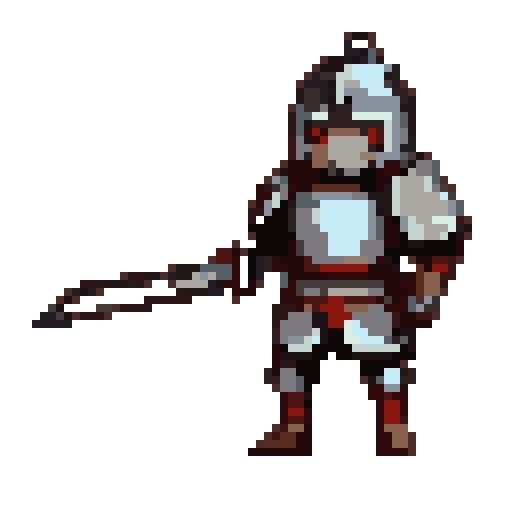
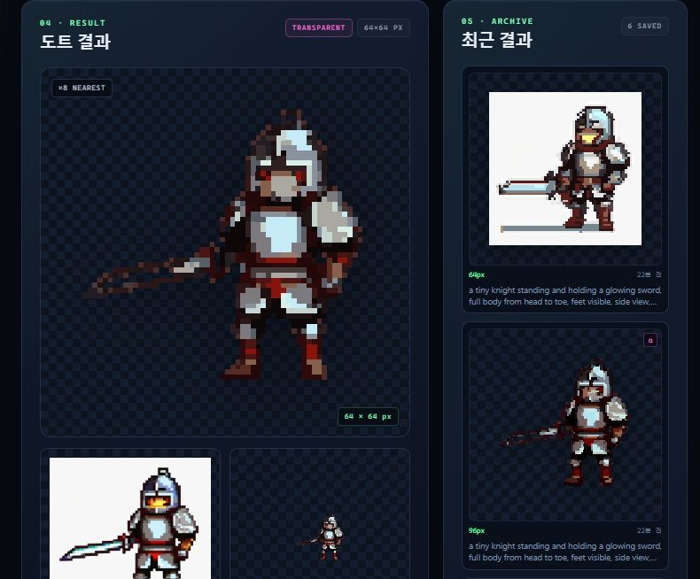
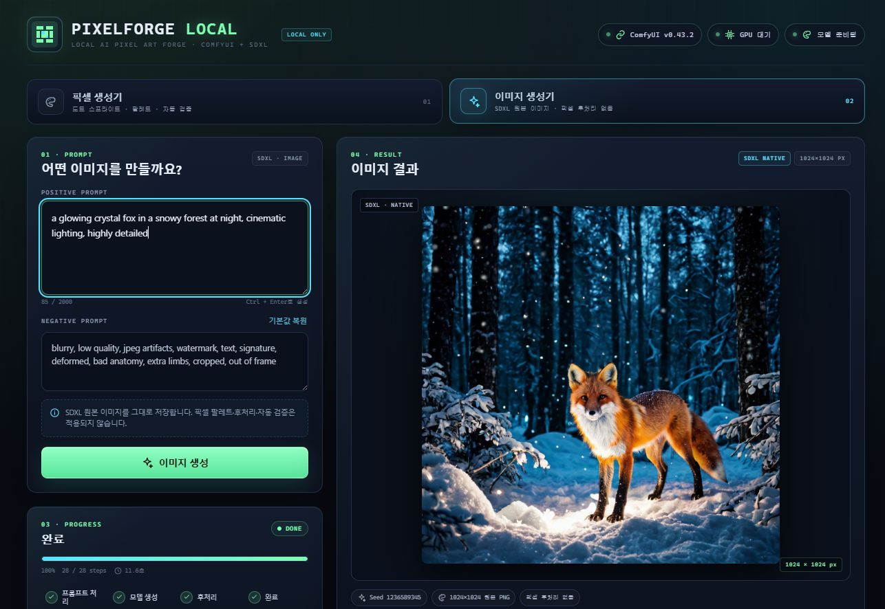

# PixelForge Local

로컬 ComfyUI + SDXL로 텍스트 프롬프트에서 **픽셀아트 스프라이트**와 **일반 이미지**를 만드는 Windows 전용 앱입니다.
외부 이미지 생성 API를 사용하지 않으며, 모든 생성은 이 PC의 GPU에서 실행됩니다.

- **페이지**: 상단의 `픽셀 생성기` / `이미지 생성기` / `이미지to이미지 느낌` / `만화 작업실` 탭으로 전환
- **이미지to이미지(레퍼런스)**: 참고 이미지를 업로드하거나 제공된 샘플 중에서 고르고,
  이미지마다 초점(외형·얼굴·화풍·포즈·구도)과 강도를 지정해 새 이미지에 반영
  (IP-Adapter Plus + CLIP Vision ViT-H, SDXL/NoobAI 계열 체크포인트 호환)
- **참고 이미지 분석**: 업로드/샘플 이미지의 방향·밝기·채도·주요 색·피사체 위치를
  자동 분석해 카드에 표시하고 작업 메타데이터에 함께 저장
- **호환성 안내**: IP-Adapter 노드/모델이 없거나 SDXL 계열이 아닌 체크포인트를 고르면
  무엇을 설치·선택해야 하는지 화면과 오류 메시지로 안내
- **얼굴 동일성 고정**: InstantID / PuLID로 참고 이미지 한 장의 얼굴을 그대로 유지하며
  새 장면을 생성 (별도 커스텀 노드·모델·insightface 필요, 화면에서 설치 상태 표시).
  얼굴 강도·구조(포즈) 제어·노이즈를 따로 조절해 프롬프트가 장면을 결정하도록 조정 가능
- **만화 컷 크기**: 이미지·레퍼런스 페이지에서 정사각형/세로 컷(832×1216)/가로 컷(1216×832) 중
  고를 수 있어 연재 만화 판 비율로 바로 그릴 수 있습니다
- **페이지별 모델**: 픽셀 페이지에는 pixel/sprite 계열, 이미지·레퍼런스 페이지에는 SDXL 일반 모델만 표시
- **이미지 LoRA**: `sexy` 슬라이더 LoRA 선택 시 트리거 단어를 이미지 프롬프트에 자동 추가
- **한국어 → 영어 번역**: 이미지/레퍼런스 페이지의 한국어 프롬프트를 오프라인 ONNX 모델
  (`opus-mt-ko-en`)로 자동 번역해 SDXL에 전달 (기본 켜짐, 영어 입력은 그대로 사용)
- **다운로드/삭제**: 결과 패널과 갤러리 카드에서 PNG 다운로드 및 결과 삭제
- **생성 정보 인스펙터**: 결과 카드의 `ⓘ` 버튼(또는 결과 패널의 `생성 정보`)을 누르면
  그 결과를 만든 프롬프트(원문·번역문), 네거티브, 체크포인트, LoRA, 스텝/CFG/샘플러,
  해상도·시드, 후처리, 참고 이미지, 얼굴 고정 설정까지 모두 다시 볼 수 있습니다
- **실시간 자원 표시**: 상단 스트립에서 GPU 사용률, VRAM, 시스템 RAM, 대기열 수를 2.5초마다 갱신
- **작업 목록/이어보기**: 최근 작업을 상태·진행률과 함께 표시하고, 페이지를 새로고침해도
  실행 중인 작업을 자동으로 복원해 진행 상황을 계속 보여줌 (작업 중 취소 가능)
- **입력**: 텍스트 프롬프트 (한국어/영어 모두 가능)
- **모드**: 아이콘 / 캐릭터 / 게임 오브젝트 / 타일·배경
- **출력**: 16 / 32 / 64 / 96 / 128px 실제 크기 PNG
- **프롬프트 구조화**: 한국어 요청 → 피사체/시점/구도/배경/팔레트 구조화, Ollama가 있으면 로컬 LLM 사용
- **투명 배경**: 패딩 rembg(u2net) + 단색 배경 색상 키 + 주 피사체 선택
- **구도 보정**: 피사체 bbox 추출 → 중앙 배치 → 목표 채움(75~85%) → 리사이즈
- **후보 자동 선택**: 픽셀 페이지에서 기본 4개 시드를 생성해 카드/패널·중복·구도 점수가 가장 높은 후보 선택
- **모델 선택/다운로드**: 설정 화면에서 체크포인트·LoRA를 드롭다운으로 바로 교체하고,
  `모델 목록` 버튼을 누르면 전체 카탈로그를 간결한 리스트로 확인·다운로드할 수 있음
- **모델 특징 표시**: 선택한 체크포인트/LoRA의 설명·특징·NSFW 여부·트리거·권장 강도를 표시
- **모델별 최적값**: 체크포인트/LoRA를 바꾸거나 페이지를 전환하면 현재 모델에 맞는
  권장 샘플링 값(예: Pony 30 steps·CFG 7.0, LUSTIFY! 30 steps·CFG 5.5)이 자동 적용되고,
  `모델 최적값` 버튼으로 언제든 다시 적용할 수 있음
- **무검열 모델 라인업**: LUSTIFY!, Pony Diffusion, CyberRealistic, epiCRealism, RealVisXL과
  디테일/필름/셀카/NSFW 슬라이더 LoRA 제공
- **비교**: AI 원본 / 배경 제거 / 자동 크롭 / 최종 도트를 나란히 표시
- **자동 검증**: 중앙 배치, 피사체 크기, 단일 오브젝트, 카드/패널, 잘림, 알파, 출력 크기, NN 경계 확인
- **미리보기**: 픽셀은 nearest-neighbor 확대 + 체커보드, 이미지는 원본 비율 유지
- **저장**: 픽셀은 실제 크기 그대로, 이미지는 선택한 512/768/1024px 원본 PNG
- **UI**: React + TypeScript + Vite, 공통 패널 컴포넌트를 픽셀/이미지 두 페이지에서 재사용
- **서버**: FastAPI + Pillow + NumPy, DB 없음





---

## 1. 요구 사항

| 항목 | 권장 |
|---|---|
| OS | Windows 10/11 |
| GPU | NVIDIA RTX 3080 Ti 12GB (검증 환경). 8GB 이상 권장 |
| ComfyUI | 기존 ComfyUI Desktop(standalone) 설치 |
| Python | 3.11–3.13 (검증: 3.11.9, 백엔드용 시스템 Python) |
| Node.js | 20+ (프론트엔드 빌드용) |
| 기본 모델 | 픽셀: SDXL 1.0 base + pixel-art-xl LoRA · 이미지: LUSTIFY! v2.0 (+ sexy LoRA 선택) |

> `start.bat`은 설치된 Python 중 3.11 → 3.12 → 3.13 순서로 선택합니다.
> 최신 Python(예: 3.15)은 고정된 패키지 wheel 호환성 때문에 사용하지 않습니다.

현재 프로젝트의 `config/settings.yaml`은 이 PC의 ComfyUI Desktop 설치 경로에 맞춰져 있습니다.
다른 PC에서 사용할 때는 아래 경로를 수정하세요.

```yaml
comfyui:
  install_dir: 'C:\Users\<사용자>\AppData\Local\Comfy-Desktop\ComfyUI-Installs\ComfyUI'
  python_path: '...\ComfyUI\.venv\Scripts\python.exe'
  main_path: '...\ComfyUI\main.py'
  models_dir: 'C:\Users\<사용자>\AppData\Local\Comfy-Desktop\ComfyUI-Shared\models'
```

---

## 2. 빠른 시작

1. `start.bat`을 더블클릭합니다.
2. 처음 실행 시 자동으로:
   - `backend/.venv` 생성
   - `backend/requirements.txt` 설치
   - 한국어→영어 번역 모델(약 115MB)이 없으면 내려받기
   - `frontend/dist`가 없으면 `npm install` + `npm run build`
   - FastAPI 서버를 `http://0.0.0.0:8765`(모든 인터페이스)에서 시작
   - 브라우저 자동 열기 (`http://127.0.0.1:8765`)
3. ComfyUI가 꺼져 있으면 기존 ComfyUI 설치를 자동으로 기동합니다.
   (자동 기동이 싫으면 `config/settings.yaml`의 `comfyui.auto_start: false`)
4. 상단에서 **픽셀 생성기**, **이미지 생성기**, **이미지to이미지 느낌** 페이지를 고릅니다.
5. 프롬프트를 입력하고 **도트 생성**, **이미지 생성**, **레퍼런스 생성** 중 하나를 누릅니다.

> `start.bat`은 이미 백엔드가 실행 중이면 중복 실행하지 않고 브라우저만 엽니다.

### 수동 실행

```bat
cd /d C:\workspace\pix
backend\.venv\Scripts\python.exe -m uvicorn app.main:app --host 0.0.0.0 --port 8765
```

백엔드 작업 디렉터리는 `backend`여야 합니다.

```bat
cd /d C:\workspace\pix\backend
.venv\Scripts\python.exe -m uvicorn app.main:app --host 0.0.0.0 --port 8765
```

프론트엔드 개발 모드:

```bat
cd /d C:\workspace\pix\frontend
npm run dev
```

Vite 개발 서버(`http://127.0.0.1:5173`)는 `/api`, `/files`를 8765로 프록시합니다.

### 다른 PC에서 이 PC의 GPU 사용하기

백엔드는 기본적으로 `0.0.0.0:8765`에 바인딩되어 같은 LAN의 다른 PC에서 접속할 수
있습니다. UI는 백엔드가 직접 서빙하므로 다른 PC에서는 별도 빌드 없이 아래 주소를
열면 됩니다.

**같은 Wi-Fi/LAN**

1. 이 PC에서 `start.bat`을 실행합니다. 콘솔에 `LAN: http://192.168.0.3:8765`가 표시됩니다.
2. 처음 한 번만 `scripts\allow_lan_firewall.bat`을 **관리자 권한**으로 실행합니다.
   (TCP 8765 인바운드를 로컬 서브넷에만 허용)
3. 다른 PC 브라우저에서 `http://192.168.0.3:8765`를 엽니다.
   ComfyUI/모델/결과물 모두 이 PC의 것을 그대로 사용합니다.

**다른 네트워크/외부에서 접속 (Cloudflare Tunnel)**

`share_tunnel.bat`은 Cloudflare Quick Tunnel(HTTPS)을 열고 그 주소를 GitHub Pages
빌드에 넣어 자동 재배포합니다. 포트 포워딩이나 공유기 설정이 필요 없습니다.

1. 이 PC에서 `start.bat`을 실행해 백엔드와 ComfyUI를 켭니다.
2. `scripts\share_tunnel.bat`을 실행합니다.
3. 콘솔에 표시되는 `https://....trycloudflare.com` 주소를 확인합니다.
   (클립보드에도 복사됩니다. 이 창을 닫으면 공유가 중지됩니다.)
4. 다른 PC에서 <https://bgm5768.github.io/pix/>를 열면 새 터널 주소가 적용되어 있습니다.

터널 주소는 실행할 때마다 바뀝니다. Pages를 다시 배포하지 않고 주소만 바꾸려면
UI의 연결 오류 배너에 있는 **백엔드 주소** 입력란에 새 터널 주소를 붙여넣고
**연결**을 누르세요. 입력한 주소는 그 브라우저의 `localStorage`에 저장됩니다.
같은 방식으로 LAN 주소(`http://192.168.0.3:8765`)를 넣을 수도 있습니다.

> **보안 경고**: Quick Tunnel 주소를 아는 사람은 누구나 이 PC의 GPU로 이미지를
> 생성할 수 있습니다. 공유를 멈추려면 `share_tunnel.bat` 창을 닫거나 Ctrl+C를
> 누르세요. 공유 중에는 터널 주소를 공개 채널에 올리지 마세요.

**GitHub Pages 배포**

- 배포된 UI: <https://bgm5768.github.io/pix/>
- `scripts\deploy_pages.bat`: `/pix/` 빌드 + `gh-pages` 푸시. API 주소는
  `.env.pages`의 `http://127.0.0.1:8765`로 되돌립니다(같은 PC용).
- `scripts\share_tunnel.bat`: 터널 URL을 넣어 빌드/배포한 뒤 로컬 빌드를 복구합니다.
- Pages 소스: 저장소 **Settings → Pages** → `gh-pages` 브랜치 `/ (root)`.

Pages는 **정적 UI만** 호스팅합니다. 생성 요청은 항상 사용자가 지정한 백엔드
(같은 PC의 `127.0.0.1`, LAN 주소, 또는 터널 주소)로 전달되며 ComfyUI와 GPU는
이 PC에서만 동작합니다. `config/settings.yaml`의 `app.cors_origins`에 등록된
`https://bgm5768.github.io`만 CORS를 허용하고 Private Network Access 응답 헤더도
함께 보냅니다.

**원격 접속 검증 (2026-11-11)**: `share_tunnel.bat`으로 Quick Tunnel을 열고
`https://bgm5768.github.io/pix/`에서 원격 생성을 확인했습니다. 작업 ID
`b5225f5c5517`, LUSTIFY! v2.0, 1024×1024, 28 steps, **13.2초**, PNG 다운로드
`200 image/png` (1,426,033 bytes). 터널을 통한 `/api/health`, `/api/config`,
모델 목록, 갤러리, CORS preflight가 모두 `200`이었고 콘솔 오류는 없었습니다.
연결 오류 배너의 **백엔드 주소** 입력으로 잘못된 주소 → 새 터널 주소로 전환하는
동작도 확인했습니다.



**배포 검증 (2026-11-11)**: `https://bgm5768.github.io/pix/`에서 LUSTIFY! v2.0 +
1024×1024 + 28 steps로 이미지를 생성했습니다. 작업 ID `660e2451930d`, **11.6초**,
원본 1,580,103 bytes, 다운로드 `200 image/png`를 확인했습니다.
Pages UI → CORS preflight `200` → 로컬 백엔드/ComfyUI → RTX 3080 Ti 경로가
HTTPS 페이지에서 그대로 동작합니다. 픽셀 페이지도 Pages UI에서 모델 목록/갤러리가
정상 로드되고 콘솔 오류가 없음을 확인했습니다.

> HTTPS Pages에서 `http://127.0.0.1`로 접속하는 것은 루프백 예외로 허용되지만,
> 브라우저 버전/보안 정책에 따라 차단될 수 있습니다. 연결이 되지 않으면 최신
> Chrome/Edge에서 로컬 네트워크 권한을 허용하거나, `share_tunnel.bat`으로 HTTPS
> 터널을 열어 사용하세요. LAN의 평문 `http://192.168.0.3:8765`는 HTTPS Pages에
> 혼합 콘텐츠로 차단될 수 있으므로, 같은 LAN에서는 다른 PC에서 백엔드 주소를
> 직접 여는 편이 확실합니다.

---

## 3. 모델 준비

### 3.1 SDXL 1.0 base

- 파일: `sd_xl_base_1.0.safetensors` (약 6.46GB)
- 다운로드:
  <https://huggingface.co/stabilityai/stable-diffusion-xl-base-1.0/resolve/main/sd_xl_base_1.0.safetensors>
- 저장 위치:
  `C:\Users\<사용자>\AppData\Local\Comfy-Desktop\ComfyUI-Shared\models\checkpoints\`
- 이 파일은 픽셀 페이지의 기본 체크포인트입니다. 이미지 페이지에서도 선택할 수 있지만,
  이미지 페이지의 기본값은 아래 LUSTIFY! v2.0입니다. `NoobAI-XL` 같은 SDXL 호환 모델도
  이미지 페이지 목록에 표시됩니다.

### 3.2 무검열 이미지 모델 라인업 (기본 LUSTIFY! v2.0)

이미지 페이지에는 무검열 포토리얼 SDXL 체크포인트를 기본으로 연결해 두었습니다.

- 기본 체크포인트: `lustifySDXLNSFWSFW_v20.safetensors` (약 6.46GB)
  - Civitai `LUSTIFY! [SDXL NSFW & SFW checkpoint]` v2.0 (모델 573152 / 버전 708635)
  - Hugging Face 미러: <https://huggingface.co/shootstuff/LUSTIFY-v2.0>
  - SDXL 1.0 기반, 자연어 프롬프트, NSFW/SFW 모두 지원
- 추가 체크포인트 (설정 → 모델 받기에서 설치):
  - `ponyDiffusionV6XL_v6StartWithThisOne.safetensors` — Pony Diffusion V6 XL,
    애니/만화·furry, 권장 프리픽스 `score_9, score_8_up, score_7_up`
  - `CyberRealisticXLPlay_V10.0_FP16.safetensors` — CyberRealistic XL v10.0,
    인물 피부·조명 포토리얼
  - `epicrealismXL_v7FinalDestination.safetensors` — epiCRealism XL v7,
    시네마틱 실사·자연광
  - `RealVisXL_V5.0_fp16.safetensors` — RealVisXL V5.0, 범용 포토리얼
- LoRA: `sexy.safetensors` (약 8.4MB, MIT)
  - <https://huggingface.co/ntc-ai/SDXL-LoRA-slider.sexy>
  - SDXL 1.0 기반 NSFW 강도 슬라이더, 트리거 `sexy`
  - 권장 강도 1.2 (UI에서 0~3 조절 가능)
- 디테일/스타일 LoRA: `extremely detailed`, `raw`, `FilmGrain Redmond`,
  `Selfie Photography Redmond`, `Analog Redmond V2` — 각 LoRA의 트리거는 선택 시
  이미지 프롬프트 끝에 자동 추가됩니다.

> **프롬프트 검열에 대해**: 이 앱과 로컬 ComfyUI에는 프롬프트 키워드 필터가 없습니다.
> 이미지 페이지의 프롬프트는 가공 없이 그대로 ComfyUI에 전달되며, 결과의 검열 여부는
> 전적으로 체크포인트 가중치에 달려 있습니다. 위 체크포인트는 NSFW 프롬프트를 거부하도록
> 학습되지 않은 모델입니다. LoRA의 `sexy` 트리거는 검열 우회가 아니라 LoRA를 활성화하는
> 단어이며, LoRA를 선택하면 이미지 프롬프트 끝에 자동으로 추가됩니다(픽셀 페이지는 제외).

> **라이선스/사용 제한**: LUSTIFY v2.0의 Civitai 설정은 `allowCommercialUse: [RentCivit, Image]`,
> `allowNoCredit: false`, 파생 모델 허용입니다. 생성 이미지를 상업적으로 쓸 때는 제작자
> 크레딧을 표시해야 하며, 모델 파일 자체의 재배포 조건은 원본 모델 카드를 따릅니다.
> 성인 콘텐츠는 법적 성인만, 실제 인물·미성년자와 무관한 로컬 생성에만 사용하세요.

### 3.3 pixel-art-xl LoRA

- 파일: `pixel-art-xl.safetensors` (약 159MB)
- 다운로드:
  <https://huggingface.co/nerijs/pixel-art-xl/resolve/main/pixel-art-xl.safetensors>
- 저장 위치:
  `C:\Users\<사용자>\AppData\Local\Comfy-Desktop\ComfyUI-Shared\models\loras\`

### 3.4 화면에서 다른 모델 받기 · 교체

설정 패널의 **MODEL STACK**에서 바로 바꿀 수 있습니다.

- **CHECKPOINT / LoRA 드롭다운**: ComfyUI에 등록된 모델을 즉시 선택합니다.
  선택값은 브라우저에 저장되고 다음 생성 요청에 `checkpoint` / `lora`로 전달됩니다.
  픽셀 페이지에는 파일명에 `pixel`, `sprite`, `dot`, `8bit`, `retro` 등이 포함된 모델만,
  이미지 페이지에는 그 외 SDXL 호환 일반 모델만 표시됩니다. 페이지별 선택값은 따로 저장됩니다.
- **모델 받기**: 아래 curated 목록에서 `받기`를 누르면 ComfyUI 모델 폴더로 바로 다운로드합니다.
  진행률·속도가 표시되고, 완료 후 목록에 자동으로 추가됩니다.
- LoRA를 쓰지 않으려면 LoRA 드롭다운에서 `사용 안 함`을 선택합니다.
- `hunyuan3d`, `sam3.1`처럼 SDXL 텍스트→이미지용이 아닌 파일은 두 페이지 모두에서 제외됩니다.

기본 제공 다운로드 목록:

| 종류 | 모델 | 크기 | 특징 |
|---|---|---|---|
| 체크포인트 | PixelArtDiffusionXL · SpriteShaper | 약 6.46GB | 픽셀아트/스프라이트 |
| 체크포인트 | LUSTIFY! v2.0 (무검열 이미지 기본) | 약 6.46GB | 포토리얼 NSFW/SFW |
| 체크포인트 | Pony Diffusion V6 XL | 약 6.46GB | 애니/만화·furry, NSFW |
| 체크포인트 | CyberRealistic XL v10.0 | 약 6.46GB | 인물 피부/조명 포토리얼, NSFW |
| 체크포인트 | epiCRealism XL v7 | 약 6.47GB | 시네마틱 실사, NSFW |
| 체크포인트 | RealVisXL V5.0 | 약 6.46GB | 범용 포토리얼 |
| LoRA | PixelArtRedmond · Lite64 | 약 163MB | 픽셀아트 |
| LoRA | Pixel Art SDXL DoRA v0.9 | 약 357MB | 강한 픽셀 스타일 |
| LoRA | Pixel Art LoRA SDXL | 약 177MB | 가벼운 픽셀 |
| LoRA | NTC Slider · sexy | 약 8.4MB | NSFW 강도 슬라이더 |
| LoRA | NTC Slider · extremely detailed | 약 8.4MB | 디테일/질감 강화 |
| LoRA | NTC Slider · raw | 약 8.4MB | 사진 원본 질감/대비 |
| LoRA | FilmGrain Redmond | 약 163MB | 필름 그레인/아날로그 색감 |
| LoRA | Selfie Photography Redmond | 약 163MB | 셀카/인물 사진 |
| LoRA | Analog Redmond V2 | 약 163MB | 필름 카메라/빈티지 |

> **PC 권장 사양**: 현재 검증 환경은 RTX 3080 Ti 12GB VRAM / 32GB RAM입니다.
> 위 SDXL 체크포인트는 512~1024px 생성에 적합하며, 1024px에서는 VRAM 사용량이 높아
> ComfyUI가 다른 모델을 동시에 올리지 않도록 주의하세요. 12GB 이하에서는 768px가 안전합니다.

> **모델 특징 표시**: 체크포인트/LoRA를 선택하면 설정 패널에 설명, 특징 태그, NSFW 여부,
> 권장 프리픽스/트리거, 권장 강도가 표시됩니다. 모델 받기 목록에서도 같은 정보를 미리
> 확인할 수 있습니다.

> **모델별 최적값**: 체크포인트나 LoRA를 바꾸면 해당 모델에 맞춰 STEPS / CFG / LoRA
> STRENGTH가 자동으로 적용됩니다. 페이지를 전환해도 그 페이지의 모델 기준으로 다시
> 맞춰집니다. 설정 패널의 `모델 최적값` 버튼으로 같은 값을 수동으로 다시 적용할 수도
> 있으며, 이미 최적값이면 `최적값 사용 중`으로 표시됩니다. 처음 페이지를 열 때는
> 저장된 설정을 덮어쓰지 않습니다. 알려진 모델의 권장값은 아래와 같습니다.
>
> | 체크포인트 | STEPS | CFG |
> |---|---|---|
> | SDXL 1.0 Base | 30 | 7.0 |
> | Pony Diffusion V6 XL | 30 | 7.0 |
> | NoobAI-XL v1.0 | 28 | 5.5 |
> | LUSTIFY! v2.0 | 30 | 5.5 |
> | CyberRealistic XL v10.0 | 30 | 5.0 |
> | epiCRealism XL v7 | 30 | 5.5 |
> | RealVisXL V5.0 | 30 | 5.0 |
> | PixelArtDiffusionXL SpriteShaper | 30 | 7.0 |
>
> LoRA 강도는 pixel-art-xl 0.80, PixelArtRedmond Lite64 0.80, Pixel Art DoRA 0.85,
> Pixel Art LoRA SDXL 0.70, `sexy` 1.20, extremely detailed 1.00, raw 1.00,
> FilmGrain/Selfie/Analog 0.80을 사용합니다. 목록에 없는 모델은 이름 계열
> (Pony/NoobAI, 포토리얼, 픽셀)에 따라 28~30 steps / CFG 5.0~7.0을 자동 제안합니다.

`config/settings.yaml`의 `generation.checkpoint` / `generation.lora`는 화면에서 아무것도
선택하지 않았을 때 사용하는 기본값입니다. 이미지 페이지는 `generation.image_checkpoint` /
`generation.image_lora` / `generation.default_image_size` / `generation.image_default_candidates`를,
레퍼런스 페이지는 `generation.reference_checkpoint` / `generation.reference_lora` /
`generation.reference_default_size` / `generation.reference_default_strength` /
`generation.reference_default_focus` / `generation.reference_max_references`를 사용합니다.

> 다운로드 모델의 라이선스는 각 Hugging Face 저장소(모델 카드)를 확인하세요.
> 이 프로젝트는 로컬 추론만 하며 모델 파일을 재배포하지 않습니다.

### 3.5 레퍼런스 이미지용 IP-Adapter Plus

이미지to이미지(레퍼런스) 페이지는 **IP-Adapter Plus**로 참고 이미지의 조건을 SDXL에 주입합니다.
커스텀 노드와 모델 3종이 모두 있어야 동작합니다.

| 파일 | 크기 | 저장 위치 | 출처 |
|---|---|---|---|
| `ip-adapter-plus_sdxl_vit-h.safetensors` | 약 808MB | `models\ipadapter\` | [h94/IP-Adapter](https://huggingface.co/h94/IP-Adapter) `sdxl_models/` |
| `ip-adapter-plus-face_sdxl_vit-h.safetensors` | 약 808MB | `models\ipadapter\` | 위와 동일 (얼굴 전용) |
| `CLIP-ViT-H-14-laion2B-s32B-b79K.safetensors` | 약 2.35GB | `models\clip_vision\` | 위와 동일 `models/image_encoder/model.safetensors` |

커스텀 노드:

```bat
cd /d "%LOCALAPPDATA%\Comfy-Desktop\ComfyUI-Installs\ComfyUI\ComfyUI\custom_nodes"
git clone --depth 1 https://github.com/cubiq/ComfyUI_IPAdapter_plus.git
```

설치 후 **ComfyUI를 반드시 재시작**해야 노드가 등록됩니다.
레퍼런스 페이지 상단의 상태 배너에 `NODE / PLUS / FACE / CLIP-VISION / SDXL` 항목이
있으며, 하나라도 비어 있으면 무엇을 설치해야 하는지 안내 문구가 표시됩니다.

- `PLUS` 만 있어도 외형·화풍·구도 참고가 동작합니다.
- `FACE`는 얼굴 초점을 선택했을 때 사용합니다. 없으면 일반 PLUS로 대체하고 안내합니다.
- 지원 체크포인트: SDXL 계열(SDXL 1.0, NoobAI-XL, Pony, Illustrious, LUSTIFY! 등).
  Flux/SD3/Hunyuan 등 비-SDXL 모델은 호환성 안내와 함께 생성이 차단됩니다.
- 애니메 모델(NoobAI/Pony)에 실사 참고 사진을 넣을 때는 강도 0.4~0.7을 권장합니다.

### 3.6 얼굴 동일성 유지 (InstantID · PuLID)

레퍼런스 페이지에서 참고 이미지 한 장의 **얼굴을 그대로 유지**하고 싶을 때 사용합니다.

| 파일 | 크기 | 저장 위치 | 출처 |
|---|---|---|---|
| `ip-adapter.bin` (InstantID) | 약 1.61GB | `models\instantid\` | [InstantX/InstantID](https://huggingface.co/InstantX/InstantID) |
| `controlnet-instantid.safetensors` | 약 2.33GB | `models\controlnet\` | 위와 동일 (`ControlNetModel/diffusion_pytorch_model.safetensors`) |
| `ip-adapter_pulid_sdxl_fp16.safetensors` (PuLID) | 약 755MB | `models\pulid\` | [huchenlei/ipadapter_pulid](https://huggingface.co/huchenlei/ipadapter_pulid) |
| `antelopev2` (얼굴 인식) | 약 344MB | `models\insightface\models\antelopev2\` | [MonsterMMORPG/tools](https://huggingface.co/MonsterMMORPG/tools) 의 `antelopev2.zip` |

커스텀 노드와 파이썬 패키지:

```bat
cd /d "%LOCALAPPDATA%\Comfy-Desktop\ComfyUI-Installs\ComfyUI\ComfyUI\custom_nodes"
git clone --depth 1 https://github.com/cubiq/ComfyUI_InstantID.git
git clone --depth 1 https://github.com/cubiq/PuLID_ComfyUI.git

cd /d "%LOCALAPPDATA%\Comfy-Desktop\ComfyUI-Installs\ComfyUI\ComfyUI"
.venv\Scripts\python.exe -m pip install insightface onnxruntime timm ftfy facexlib
```

> `antelopev2.zip`은 `models\insightface\models\antelopev2\`에 풀어 넣습니다.
> PuLID의 EVA02-CLIP-L-14-336은 첫 실행 때 자동으로 내려받습니다(Hugging Face 캐시).
> 설치 후 **ComfyUI를 반드시 재시작**하세요.

레퍼런스 페이지의 **얼굴 동일성 고정(FACE IDENTITY)** 영역에서
`사용 안 함 / InstantID / PuLID`를 고르고, 얼굴 고정용 참고 이미지와 강도를 지정합니다.
설치 상태는 `NODE/PLUS/FACE/CLIP-VISION/SDXL` 배너와 함께 표시되며, 필요한 항목이 없으면
무엇을 설치해야 하는지 안내합니다.

- **InstantID**: 얼굴 임베딩 + SDXL ControlNet(키포인트)으로 얼굴을 강하게 고정합니다.
  단일 인물 초상에 가장 잘 맞습니다. CFG를 4~5로 낮추면 얼굴이 더 자연스럽습니다.
  1024px에서는 워터마크가 생길 수 있어 768px를 권장합니다.
- **PuLID**: ID 임베딩을 UNet에 직접 주입합니다. EVA-CLIP을 추가로 사용하므로 VRAM을 더
  먹고 기준 체크포인트에 따라 편차가 있습니다. `fidelity`(참조에 충실)/`style`(자유도)/
  `neutral` 방식을 선택할 수 있습니다.

### 3.7 배경 분리 모델 (rembg)

투명 배경을 켜면 로컬 `rembg`가 u2net 모델을 사용합니다.
첫 실행 시 자동으로 다운로드됩니다(약 176MB).

```
C:\Users\<사용자>\.rembg\models\u2net\u2net.onnx
```

픽셀아트 아이콘이 프레임을 가득 채우면 u2net이 배경을 구분하지 못하는 경우가 있어,
가장자리 색으로 이미지를 패딩한 뒤 분리합니다. 분리된 마스크는 테두리 단색 색상 키와
결합해 스프라이트 시트 이음선을 제거하고, 가장 큰 주 피사체만 남깁니다.
인터넷이 없거나 모델 다운로드에 실패하면 내장된 색상 플러드필 방식으로 자동 대체되고,
UI에 경고가 표시됩니다. `config/settings.yaml`에서 `generation.rembg_enabled: false`로 끌 수도 있습니다.

### 3.8 한국어 → 영어 번역 모델 (opus-mt-ko-en)

이미지 페이지의 자동 번역은 PyTorch 없이 CPU에서 도는 양자화 ONNX 모델을 사용합니다.

- 모델: `Helsinki-NLP/opus-mt-ko-en`의 ONNX 양자화 빌드 (Xenova 배포)
- 저장 위치: `models/translation/opus-mt-ko-en/`
- 크기: encoder 52.9MB + decoder 59.8MB (약 115MB)
- 구성: `onnx/encoder_model_quantized.onnx`, `onnx/decoder_model_quantized.onnx`,
  `config.json`, `source.spm`, `target.spm`, `vocab.json`
- 수동 다운로드: `scripts\download_translation_model.bat`
- 사용 패키지: `onnxruntime`, `transformers`(토크나이저 전용), `sentencepiece`, `sacremoses`

`start.bat`이 모델 파일이 없을 때 자동으로 내려받습니다. `models/translation/`은
`.gitignore`에 포함되어 저장소에는 올라가지 않습니다. 번역을 끄려면
`config/settings.yaml`의 `translation.enabled: false`로 설정하세요.

---

## 4. 사용 방법

상단의 세 탭은 각각 독립된 프롬프트·설정·결과·갤러리를 가집니다. 페이지를 바꿔도
진행 중인 작업과 선택한 모델은 유지됩니다.

### 4.1 픽셀 생성기

1. **POSITIVE PROMPT**에 만들고 싶은 캐릭터/오브젝트를 입력합니다.
   예: `도서관 아이콘 만들어줘`, `귀여운 고양이 캐릭터 한 명 만들어줘`
2. **ASSET MODE**에서 아이콘 / 캐릭터 / 게임 오브젝트 / 타일·배경을 선택합니다.
   아이콘·캐릭터·오브젝트 모드는 단일 피사체만 남기고, 타일 모드만 반복 배경을 허용합니다.
   설정 패널 상단의 **MODEL STACK**에서 현재 체크포인트/LoRA를 확인하고 드롭다운으로
   바로 교체할 수 있습니다. `모델 받기` 목록에서 새 SDXL 모델도 내려받을 수 있습니다.
   LoRA를 끄려면 LoRA 드롭다운에서 `사용 안 함`을 선택합니다.
3. **NEGATIVE PROMPT**는 기본값을 그대로 두는 것을 권장합니다.
4. **OUTPUT RESOLUTION**에서 16/32/64/96/128px를 선택합니다.
5. 필요하면 Seed, Steps, CFG, LoRA Strength, Post-process, 팔레트 색상,
   Resize Filter, 투명 배경을 조정합니다.
6. **도트 생성**을 누릅니다.
7. 결과 패널에서:
   - AI 원본(512×512) / 배경 제거 / 자동 크롭 / 최종 도트를 비교
   - 자동 검증 결과(중앙 배치, 피사체 크기, 단일 오브젝트, 잘림, 알파 등) 확인
   - 실제 픽셀 크기와 팔레트 색상 수 확인
   - **PNG 저장**으로 실제 크기 PNG 다운로드
   - **다시 생성**으로 새 시드 재생성
   - **삭제**로 이 작업의 원본·후보·최종 결과·메타데이터 제거
8. 최근 결과는 오른쪽 **ARCHIVE** 갤러리에 저장되며, 클릭하면 다시 볼 수 있습니다.
   카드에 마우스를 올리면 다운로드/삭제 버튼이 나타납니다.

### 4.2 이미지 생성기

1. 상단에서 **이미지 생성기** 탭을 누릅니다.
2. **POSITIVE PROMPT**에 원하는 장면을 자연어로 입력합니다.
   예: `숲속을 달리는 호랑이, cinematic lighting, highly detailed, wide shot`
   한국어가 포함되어 있으면 **한국어 → 영어 자동 번역**(기본 켜짐)이 입력 아래에
   영어 프롬프트를 미리 보여줍니다. 생성 시에는 이 영어 문장이 SDXL로 전달됩니다.
   이미 영어인 문장은 번역하지 않고 그대로 사용합니다. 자동 번역을 끄려면 토글을
   해제하세요.
3. 필요하면 **NEGATIVE PROMPT**를 수정합니다. 이미지 페이지의 기본 네거티브는
   인물 해부/저품질/워터마크 위주이며 픽셀 전용 문구가 포함되지 않습니다.
   네거티브에 한국어가 있으면 이것도 함께 번역됩니다.
4. **IMAGE RESOLUTION**에서 512 / 768 / 1024px를 선택합니다. 1024px가 가장 선명합니다.
5. **MODEL STACK**에서 이미지용 체크포인트를 선택합니다. 기본값은 `LUSTIFY! v2.0`이며
   `NoobAI-XL`, `SDXL base`로 바꿀 수 있습니다. 픽셀 전용 체크포인트/LoRA는 목록에
   나타나지 않습니다. LoRA를 고르면 트리거 단어가 프롬프트에 자동 추가되고, 쓰지 않으려면
   `사용 안 함`을 선택합니다.
6. **이미지 생성**을 누릅니다. 후보는 1개만 생성됩니다.
7. 결과 패널에서 SDXL 원본 PNG를 확인하고 **PNG 저장**으로 내려받거나 **삭제**합니다.
8. 최근 이미지는 오른쪽 **이미지 갤러리**에 저장되며, 클릭하면 다시 볼 수 있습니다.
   카드에 마우스를 올리면 다운로드/삭제 버튼이 나타납니다.

이미지 페이지는 다음을 적용하지 않습니다.

- 픽셀아트 프롬프트 자동 래핑 및 픽셀 전용 네거티브
- 배경 제거 / 자동 크롭 / 팔레트 양자화 / nearest-neighbor 축소
- 후보 자동 선택과 자동 검증

즉 SDXL이 만든 원본을 그대로 보존하며, 후처리 단계 없이 저장합니다. 픽셀 결과와 이미지
결과는 서로 다른 폴더(`outputs/pixel_art`, `outputs/images`)에 저장되어 섞이지 않습니다.

### 4.3 이미지to이미지 느낌 (레퍼런스)

> **프롬프트와 참고 이미지의 관계**: 참고 이미지의 **강도**가 0.8 이상이면 사진 자체
> (배경·조명·포즈)가 그대로 복사되어 프롬프트가 무력해집니다.
> - 장면은 프롬프트로 바꾸고 참고는 성격만 가져오려면 **강도 0.2~0.4**
> - 얼굴만 그대로 유지하려면 아래 **얼굴 동일성 고정**(InstantID/PuLID) 사용
> - 참고 이미지의 화풍만 가져오려면 초점을 `화풍 · 그림체`로 지정

1. 상단에서 **이미지to이미지 느낌** 탭을 누릅니다.
2. **참고 이미지** 패널에서 참고할 이미지를 고릅니다.
   - 드롭존을 클릭하거나 끌어다 놓아 업로드(PNG/JPG/WEBP, 최대 15MB)
   - 또는 **샘플 이미지에서 선택**에서 제공된 샘플(인물 초상 / 동물 야생 / 화풍·수채화 /
     장면·구도)을 고릅니다. 최대 5장까지 가능합니다.
   - 업로드·샘플 이미지는 방향·밝기·채도·주요 색·피사체 위치를 자동 분석해 카드에 표시합니다.
3. 카드마다 **FOCUS**와 **STRENGTH**를 지정합니다.
   | 초점 | IP-Adapter 가중 방식 | 설명 |
   |---|---|---|
   | 외형 · 캐릭터 | `linear` | 생김새·색감·질감 반영 |
   | 얼굴 · 표정 | `linear` + PLUS FACE 모델 | 얼굴 특징 강조 |
   | 화풍 · 그림체 | `style transfer` | 스타일 레이어만 반영 |
   | 포즈 · 자세 | `composition` | 구도 레이어 반영 (정확한 관절 포즈는 ControlNet 필요) |
   | 구도 · 배치 | `composition precise` | 카메라 구도·피사체 배치 반영 |
   강도는 0.0~1.5 (기본 0.85)이며 0이면 해당 참고는 적용되지 않습니다.
4. **교체**로 참고 이미지를 바꾸고, 휴지통 아이콘으로 제거할 수 있습니다.
5. **POSITIVE PROMPT**에 새 장면을 입력합니다. 프롬프트와 참고 이미지는 항상 함께
   적용되므로, 참고 이미지는 "무엇을"을, 프롬프트는 "어떻게"를 결정합니다.
   한국어 프롬프트는 자동으로 영어로 번역됩니다.
6. **레퍼런스 생성**을 누릅니다. 결과는 SDXL 원본 PNG로 저장되며, 결과 패널에
   적용된 참고 이미지(초점·강도·분석 요약)가 함께 표시됩니다.

> **얼굴 동일성 유지**: IP-Adapter는 "얼굴처럼 보이는" 정도의 유사성을 만들 뿐
> 동일 인물을 보장하지 않습니다. 얼굴을 고정해야 하는 작업은 InstantID 또는 PuLID를
> 별도로 검토해야 합니다(아래 4.4).

### 4.4 얼굴 동일성 유지 (InstantID · PuLID)

레퍼런스 페이지의 **얼굴 동일성 고정(FACE IDENTITY)** 영역에서 사용할 수 있습니다.

1. 참고 이미지 중 얼굴이 정면으로 잘 보이는 한 장을 고릅니다(초점은 `얼굴 · 표정` 권장).
2. `사용 안 함` → `InstantID` 또는 `PuLID`를 선택합니다.
3. **얼굴 고정용 이미지**에서 그 참고 이미지를 고르고 **IDENTITY** 강도를 정합니다
   (기본 0.85, 0~2.0).
4. InstantID는 추가로 두 값을 조절할 수 있습니다.
   - **구조 제어** (0~3, 기본 0.5): 참고 사진의 포즈·키포인트를 따르는 정도입니다.
     낮출수록(0~0.3) 프롬프트가 포즈와 장면을 더 자유롭게 결정합니다.
   - **노이즈 주입** (0~1, 기본 0.35): 참고 이미지의 "번짐(burn)"을 줄여 얼굴을 더
     선명하게 유지합니다.
5. PuLID는 **적용 방식**도 고를 수 있습니다.
   - `fidelity`: 참조 얼굴에 가장 충실 (기본)
   - `style`: 체크포인트 자유도를 남기고 얼굴은 참고
   - `neutral`: 정규화 없이 적용 (강도를 낮춰서 사용)
6. **참고 사진의 전체 모습도 함께 적용** 체크박스(기본 끔):
   - **끄면(권장)** 얼굴만 가져오고 나머지(배경·조명·의상·장면)는 프롬프트가 결정합니다.
   - **켜면** 참고 사진이 IP-Adapter로도 적용되어 배경·조명·포즈까지 복사되고 프롬프트보다
     사진이 강해집니다.
7. **레퍼런스 생성**을 누릅니다. 프롬프트와 참고 이미지 조건에 더해 얼굴 고정 조건이 함께
   적용됩니다. 결과 패널에 `얼굴 동일성 고정 · INSTANTID/PULID`로 표시됩니다.

| 방식 | 원리 | 필요한 것 | 참고 |
|---|---|---|---|
| IP-Adapter Plus (기본) | CLIP Vision 임베딩을 교차 어텐션에 주입 | 3.5의 노드/모델 | 얼굴 "유사성", 여러 참고 동시 사용 가능 |
| InstantID | InsightFace 임베딩 + SDXL ControlNet | 3.6의 노드/모델 | 단일 인물 초상, 얼굴 고정력이 가장 강함 |
| PuLID | UNet에 ID 임베딩 직접 주입 | 3.6의 노드/모델 | InstantID보다 가볍지만 고정은 약간 낮음 |

> 얼굴을 못 찾는 사진(뒤모습·심야·손 가림 등)을 주면 생성 중
> `얼굴을 찾지 못했습니다` 오류가 납니다. 정면 사진으로 교체해 주세요.

### 4.5 만화 작업실 (nk)

4번째 탭 **만화 작업실**은 nk 만화 제작기의 작업실을 그대로 불러온다.
(새 만화 · 이어서 만들기 · 컷 다시 그리기 · 후보 고르기 · 대사/말풍선 · 쪽 짜기 · PDF 조립)

- 백엔드가 `nk ep web --port 8766 --no-open --no-runner` 로 작업실 서버를 자동으로 띄우고,
  `/studio/` 경로로 프록시해 화면을 그대로 보여준다.
- 같은 ComfyUI(`http://127.0.0.1:8188`)와 공유 모델 폴더를 쓴다.
  nk 쪽 `presets.yaml` 의 `pixelforge_*` 프리셋으로 LUSTIFY!/NoobAI/Pony 등을 바로 고를 수 있다.
- nk 의 안전장치(전연령 전용)는 그대로 적용된다. PixelForge가 그 장치를 건드리지 않는다.

설정(`config/settings.yaml`):

```yaml
studio:
  kit_path: 'C:\nk'   # nk.py 가 있는 폴더
  port: 8766          # 픽셀포지(8765)와 겹치지 않게
  python: ''          # 비우면 PATH 의 python (numpy/cv2/PIL/pyyaml 필요)
  allow_remote: false # true 면 터널(외부)로도 작업실을 연다 (기본은 이 PC 전용)
```

> 작업실은 파일을 만들고 명령을 실행하므로, 기본적으로 **이 PC에서만** 열린다
> (요청에 `X-Forwarded-For` 가 붙으면 외부 요청으로 보고 막는다).

### 4.6 만화 컷 크기

이미지 페이지와 레퍼런스 페이지의 설정 패널에는 **컷 모양** 선택이 있습니다.

| 컷 모양 | 크기 | 언제 쓰나 |
|---|---|---|
| 정사각형 | 선택한 해상도(512/768/1024) | 일반 이미지 |
| 세로 컷 | 832×1216 | 연재 만화의 한 컷(세로 판) |
| 세로 라이트 | 704×1152 | VRAM을 아껴야 할 때 |
| 가로 컷 | 1216×832 | 두 명 이상이 나오는 한 컷 |

레퍼런스 페이지에서 세로 컷 + 얼굴 고정을 같이 쓰면, 같은 캐릭터로 연재 컷을 이어서
그릴 수 있습니다.

### 4.5 생성 정보 다시 보기

- 갤러리 카드 왼쪽 위의 **ⓘ** 버튼을 누르면 해당 결과가 선택되고, 결과 패널의
  **생성 정보** 항목이 자동으로 펼쳐집니다.
- 항목 안에는 그 결과를 만들 때 사용한 값이 모두 들어 있습니다.
  - **프롬프트**: 실제로 모델에 전달된 문장(번역 사용 시 원문도 함께 표시)
  - **네거티브 프롬프트**
  - **CHECKPOINT / LoRA**: 사용한 모델 파일과 LoRA 사용 여부
  - **STEPS / CFG / LORA STRENGTH / SAMPLER·SCHEDULER**
  - **SIZE / SEED / MODE / POST-PROCESS / PALETTE / 소요시간**
  - **REFERENCES**: 참고 이미지별 초점과 강도
  - **FACE IDENTITY**: 사용한 얼굴 고정 엔진과 강도(InstantID/PuLID)
- 작업 목록(JobList)에서 과거 작업을 골라도 같은 정보를 볼 수 있습니다.
- 정보는 `outputs/metadata/<job_id>.json`에 저장된 값을 그대로 읽어 만들기 때문에
  서버를 다시 켜도 그대로 남아 있습니다.

### 4.7 다운로드 · 삭제
- **다운로드**: 결과 패널의 **PNG 저장**, 또는 갤러리 카드의 다운로드 아이콘을 누릅니다.
  픽셀은 실제 크기 PNG(`pixelforge_<job>_<size>px.png`), 이미지는 선택한 해상도의
  SDXL 원본 PNG(`pixelforge_<job>_image_<size>px.png`)로 저장됩니다.
- **삭제**: 결과 패널의 **삭제** 또는 갤러리 카드의 휴지통 아이콘을 누르고 확인합니다.
  `{job_id}_*`로 시작하는 원본·후보·컷아웃·크롭·최종 PNG·미리보기와
  `metadata/{job_id}.json`이 함께 삭제되며 되돌릴 수 없습니다.
- 생성 중이거나 대기열에 있는 작업은 삭제할 수 없습니다. 완료된 뒤 다시 시도하세요.
- 이미 삭제된 결과를 다시 삭제하면 `404 JOB_NOT_FOUND`가 반환됩니다.

### 권장 설정 (픽셀 생성기)

| 설정 | 값 |
|---|---|
| Base resolution | 512×512 (고정) |
| Sampler | DPM++ 2M Karras |
| Steps | 28 |
| CFG | 6.0 |
| LoRA strength | 0.8 |
| Output | 64px (기본), 32/64/128px 검증 완료 |
| Candidates | 4 (기본, API에서 1~8 조정 가능, 타일은 자동 1) |
| Post-process | quantize (권장) |
| Palette | 32px=16색, 64px=24색, 128px=32색 (또는 원본 색상) |
| Resize filter | nearest (기본), box / lanczos 비교 가능 |

- `quantize`: 제한 팔레트로 양자화 → 가장 픽셀아트다운 결과
- `nearest`: 다운스케일만 하고 색을 줄이지 않음 → 원본 느낌, 16px에서는 거칠 수 있음
- `posterize`: 색 단계를 단순화 → 강한 단순화
- 팔레트 `원본 색상`(0): 양자화하지 않고 원본 색을 유지합니다.
- 최종 미리보기는 항상 nearest-neighbor로 확대됩니다. 타일 모드는 box가 자동 적용됩니다.

> 자동 검증이 실패해도 결과를 삭제하거나 덮어쓰지 않습니다. 원본은 항상 보존되며,
> 경고와 미리보기를 보고 사용자가 직접 판단할 수 있습니다.

---

## 5. 동작 구조

```
[React UI · 픽셀 생성기 / 이미지 생성기 / 이미지to이미지 느낌]
   │ 이미지 + 한국어: POST /api/translate → 영어 미리보기 (ONNX, CPU)
   │ 레퍼런스: POST /api/references/upload → 참고 이미지 분석(방향/밝기/색/피사체)
   │ POST /api/generate { kind: "pixel" | "image" | "reference", prompt: 영어, translate_prompt: true }
   ▼
[FastAPI JobManager] ── 번역(방어적) ── 1개 활성 + 최대 2개 대기 ──▶ [ComfyUI HTTP/WebSocket]
   │                                                   │
   │                                                   ├─ CheckpointLoaderSimple (SDXL)
   │                                                   ├─ LoraLoader (선택 사항)
   │                                                   ├─ CLIPTextEncode (positive/negative)
   │                                                   ├─ EmptyLatentImage 512×512 또는 512/768/1024²
   │                                                   ├─ KSampler (dpmpp_2m + karras, 28 steps, CFG 6)
   │                                                   ├─ VAEDecode
   │                                                   └─ SaveImage
   │                                        (pixel: 후보 1..N, seed = base_seed + index)
   │                                        (image: 후보 1, 번역된 영어 프롬프트)
   │                                        (reference: 후보 1, IP-Adapter 조건 주입)
   ▼
   ├─ kind=pixel → [Pillow/NumPy 후처리]
   │    ├─ 패딩 rembg u2net 배경 분리 + 테두리 색상 키
   │    ├─ 주 피사체 컴포넌트 선택 (중복/스프라이트 시트 제거)
   │    ├─ 카드/패널 점수 + 자동 검증 점수로 최선 후보 선택
   │    ├─ 피사체 bbox 추출 + 중앙 배치 + 목표 채움(75~85%)
   │    ├─ premultiplied alpha 리사이즈 (nearest/box/lanczos)
   │    ├─ 제한 팔레트 양자화 + 약한 despeckle
   │    ├─ 자동 검증 (중앙/크기/단일/카드 패널/잘림/알파/출력 크기/NN 경계)
   │    └─ nearest-neighbor 미리보기 (512px)
   │
   ├─ kind=image → 후처리 없이 원본 PNG + 축소 미리보기 저장
   │
   └─ kind=reference → [IP-Adapter Plus 조건 주입]
        ├─ 참고 이미지별 LoadImage + IPAdapterAdvanced 체인
        ├─ 초점별 가중 방식 (linear / style transfer / composition)
        ├─ 얼굴 초점은 PLUS FACE 모델 사용 (미설치 시 PLUS로 대체 + 안내)
        ├─ identity_engine=instantid → InstantIDFaceAnalysis + ControlNet + ApplyInstantID
        ├─ identity_engine=pulid → PulidEvaClipLoader + ApplyPulid
        └─ 후처리 없이 원본 PNG + 축소 미리보기 저장
   ▼
outputs/
   ├─ originals/<job>_original.png           (선택된 AI 원본 512×512 RGB)
   ├─ candidates/<job>_c<index>.png          (픽셀/이미지 후보 원본)
   ├─ cutouts/<job>_cutout.png               (픽셀: 배경 제거 결과)
   ├─ crops/<job>_crop.png                   (픽셀: 피사체 자동 크롭)
   ├─ pixel_art/<job>_pixel_<size>.png       (픽셀: 최종 RGBA/RGB)
   ├─ previews/<job>_preview_<size>.png      (픽셀: nearest 확대)
   ├─ images/<job>_image_<size>.png          (이미지/레퍼런스: SDXL 원본 PNG)
   ├─ image_previews/<job>_image_preview_<size>.png (이미지/레퍼런스: 갤러리용 축소본)
   ├─ references/uploads/<up_id>.png         (업로드한 참고 이미지 원본)
   └─ metadata/<job>.json                    (프롬프트/모델/시드/설정/후보 점수/검증/결과)
```

- 원본과 최종 결과를 **별도 파일**로 보존합니다.
- 픽셀 결과는 투명 모드에서 binary alpha를 쓰는 RGBA PNG, 불투명 모드에서 RGB PNG입니다.
- 이미지 결과는 항상 RGB PNG이며, `kind: "image"`와 `image_size`가 메타데이터에 기록됩니다.
- 레퍼런스 결과도 `kind: "reference"`로 기록되며, 적용된 참고 이미지(초점·강도·분석 요약)가
  `references` 배열과 `result.references`에 남습니다.
- 이미지 프롬프트에 한글이 있으면 `JobManager`가 ONNX 번역 모델로 영어로 바꾼 뒤
  SDXL에 전달합니다. 원문은 `prompt_original`, 실제 사용 문장은 `prompt_used`,
  번역 여부는 `prompt_translated`로 메타데이터와 작업 응답에 남습니다.
- ComfyUI WebSocket으로 진행률을 받고, 완료는 `/history/{prompt_id}` 폴링으로 확인합니다.
- ComfyUI가 꺼져 있으면 작업 시작 전에 `ComfyLauncher`가 기존 설치를 자동 기동합니다.

---

## 6. API

백엔드는 `http://127.0.0.1:8765`에서 실행됩니다.

| Method | Path | 설명 |
|---|---|---|
| POST | `/api/generate` | 생성 작업 제출 (`kind`로 픽셀/이미지/레퍼런스 선택) |
| GET | `/api/jobs?limit=20&kind=image` | 최근 작업 목록 (실행 중 작업 우선, 재시작 후에도 유지) |
| GET | `/api/jobs/{job_id}` | 작업 상태/진행률/결과 조회 |
| POST | `/api/jobs/{job_id}/cancel` | 작업 취소 |
| GET | `/api/outputs?limit=30&kind=pixel` | 최근 결과 목록 (`kind=pixel` 기본, `kind=image`, `kind=reference`) |
| DELETE | `/api/outputs/{job_id}` | 결과 파일과 메타데이터 삭제 (진행 중 작업은 409) |
| POST | `/api/translate` | 한국어 프롬프트를 영어로 번역 (오프라인 ONNX, CPU) |
| GET | `/api/references/samples` | 제공된 참고 샘플 목록 |
| POST | `/api/references/upload` | 참고 이미지 업로드 (multipart `file`) → 분석 결과 포함 |
| GET | `/api/references/capabilities?checkpoint=...` | IP-Adapter/얼굴 고정 설치·호환 상태와 안내 문구 |
| GET | `/api/studio/status` | nk 만화 작업실 설치·실행 상태 |
| POST | `/api/studio/start` | nk 만화 작업실 서버 기동 |
| GET/POST | `/studio/...` | nk 작업실 화면·API 프록시 (작업실이 그대로 동작) |
| GET | `/api/system` | GPU 사용률/VRAM/온도/전력, RAM, 대기열 상태 (2.5초 폴링용) |
| GET | `/api/health` | 백엔드/ComfyUI/GPU/RAM/모델/큐 상태 |
| GET | `/api/models/catalog` | 다운로드 가능한 모델과 설치/진행 상태 |
| POST | `/api/models/downloads/{id}` | 모델 다운로드 시작 |
| POST | `/api/models/downloads/{id}/cancel` | 진행 중인 다운로드 취소 |
| GET | `/api/config` | UI 기본 설정(픽셀/이미지/레퍼런스 기본값 포함) |
| GET | `/api/download/{job_id}?kind=pixel` | 결과 PNG 다운로드 (`kind=image`, `kind=reference`) |
| GET | `/files/...` | 원본/픽셀/이미지/미리보기 정적 파일 |
| GET | `/reference-samples/...` | 제공된 참고 샘플 정적 파일 |

### 생성 예시

픽셀 생성:

```powershell
$body = @{
  kind = "pixel"
  prompt = "a tiny knight standing and holding a glowing sword, full body, feet visible, side view, game sprite, fantasy"
  mode = "character"
  output_size = 64
  seed = 987654321
  steps = 28
  cfg = 6.0
  lora_strength = 0.8
  transparent = $true
  postprocess = "quantize"
  palette_colors = 24
  resize_filter = "nearest"
  candidates = 4
  # 선택 사항: 요청별 모델 교체 (생략하면 settings.yaml 기본값)
  checkpoint = "SDXL1.0_PixelArtDiffusionXL_SpriteShaper.safetensors"
  lora = "pixel-art-xl.safetensors"
} | ConvertTo-Json

$job = Invoke-RestMethod -Uri "http://127.0.0.1:8765/api/generate" `
  -Method Post -ContentType "application/json" -Body $body

Invoke-RestMethod "http://127.0.0.1:8765/api/jobs/$($job.job_id)"
```

이미지 생성:

```powershell
$body = @{
  kind = "image"
  prompt = "a lone lighthouse on a rocky cliff at sunset, cinematic lighting, highly detailed, wide shot"
  image_size = 1024
  seed = 123456789
  steps = 28
  cfg = 6.0
  checkpoint = "lustifySDXLNSFWSFW_v20.safetensors"
  lora = ""   # 예: "sexy.safetensors" (선택 시 프롬프트에 'sexy' 자동 추가)
} | ConvertTo-Json

$job = Invoke-RestMethod -Uri "http://127.0.0.1:8765/api/generate" `
  -Method Post -ContentType "application/json" -Body $body

$result = Invoke-RestMethod "http://127.0.0.1:8765/api/jobs/$($job.job_id)"
$result.result.image_url      # /files/images/<job_id>_image_1024.png
$result.result.download_url   # /api/download/<job_id>?kind=image
```

레퍼런스(이미지to이미지) 생성:

```powershell
# 1) 참고 이미지 업로드 (multipart)
$upload = Invoke-RestMethod -Uri "http://127.0.0.1:8765/api/references/upload" `
  -Method Post -Form @{ file = Get-Item ".\my_reference.png" }
$upload.id            # up_<hash>
$upload.analysis.summary   # "세로형 · 중간 밝기 · 저채도 · 인물/캐릭터 추정 · #756f6d …"

# 2) 참고 이미지 + 프롬프트로 생성
$body = @{
  kind = "reference"
  prompt = "a woman in a red coat walking through a snowy city, cinematic lighting"
  image_size = 1024
  seed = 4242
  steps = 28
  cfg = 6.0
  checkpoint = "sd_xl_base_1.0.safetensors"
  lora = ""
  reference_images = @(
    @{ asset_id = $upload.id; strength = 0.85; focus = "face" },
    @{ asset_id = "sample_style";  strength = 0.55; focus = "style" }
  )
  # 얼굴 동일성 고정 (선택): "none" | "instantid" | "pulid"
  identity_engine = "instantid"
  identity_image = $upload.id
  identity_weight = 0.85        # 얼굴 임베딩 강도
  identity_control_weight = 0.3 # InstantID 구조(포즈) 강제 — 낮을수록 프롬프트가 주도
  identity_noise = 0.35         # 번짐 감소용 노이즈 주입
  identity_include_style = $false # $true면 참고 사진의 전체 모습도 적용(사진 복사됨)
  identity_method = "fidelity"   # pulid: fidelity | style | neutral
} | ConvertTo-Json -Depth 5

$job = Invoke-RestMethod -Uri "http://127.0.0.1:8765/api/generate" `
  -Method Post -ContentType "application/json" -Body $body

Invoke-RestMethod "http://127.0.0.1:8765/api/jobs/$($job.job_id)"
```

- `focus` 값: `appearance` / `face` / `style` / `pose` / `composition`
- `identity_engine` 값: `none`(기본) / `instantid` / `pulid`
- `identity_image`은 `reference_images`에 있는 자산 ID여야 하며, 그 이미지의 얼굴이 고정됩니다.
- `identity_include_style=false`(기본)이면 얼굴 고정용 이미지는 IP-Adapter 체인에서 제외되어
  프롬프트가 장면을 결정합니다. `true`면 참고 사진의 전체 모습이 함께 적용됩니다.
- `asset_id`는 업로드 ID(`up_…`) 또는 제공 샘플 ID(`sample_portrait`, `sample_animal`,
  `sample_style`, `sample_scene`)입니다.
- `strength` 0이면 해당 참고 이미지는 생성에 반영되지 않습니다.

한국어 프롬프트 번역:

```powershell
$body = @{ text = "숲속을 달리는 호랑이" } | ConvertTo-Json
$translated = Invoke-RestMethod -Uri "http://127.0.0.1:8765/api/translate" `
  -Method Post -ContentType "application/json" -Body $body

$translated.text        # A tiger running through a forest
$translated.translated  # True
```

- 한글이 없으면 `translated: false`와 함께 입력 문장을 그대로 돌려줍니다.
- 번역 모델은 `models/translation/opus-mt-ko-en`에 있으며 `start.bat`이 자동으로 받습니다.
- `POST /api/generate`의 `translate_prompt`(기본 `true`)가 켜져 있으면, 프론트엔드에서
  번역하지 못한 경우에도 백엔드가 이미지 프롬프트를 다시 번역합니다.

결과 삭제:

```powershell
$deleted = Invoke-RestMethod -Uri "http://127.0.0.1:8765/api/outputs/<job_id>" -Method Delete
$deleted.count     # 삭제된 파일 수
$deleted.deleted   # 삭제된 상대 경로 목록
```

`GET /api/jobs/{job_id}` 응답에는 다음 정보가 포함됩니다.

- `request.kind`, `request.image_size`: 요청한 페이지 종류와 이미지 해상도
- `result.kind`: `"pixel"`, `"image"` 또는 `"reference"`
- `result.image_url`, `result.image_preview_url`: 이미지/레퍼런스 페이지 결과 경로
- `result.references`: 레퍼런스 작업에 적용된 참고 이미지(초점·강도·분석 요약) 목록
- `result.identity`: 얼굴 동일성 고정 정보(`engine`, `image`, `weight`, `method`)
- `result.details`: 그 결과를 만든 전체 설정(프롬프트·모델·LoRA·샘플링·시드·참고 이미지)
- `prompt_original`: 사용자가 입력한 원문
- `prompt_used`: 실제 SDXL에 전달된 문장 (번역문 + LoRA 트리거)
- `prompt_translated`: 이번 작업에서 번역이 적용됐는지 여부
- `prompt_plan`: 구조화된 프롬프트(피사체/시점/구도/배경/positive/negative/source, 이미지 모드는 `null`)
- `base_seed`: 사용자가 요청한 기준 시드
- `seed_used`: 실제 선택된 후보의 시드 (`base_seed + candidate_index`)
- `result.mode`, `result.subject_fill`, `result.resize_filter`
- `result.cutout_url`, `result.crop_url` (픽셀 결과)
- `result.candidates_generated`, `result.candidate_index`, `result.candidate_score`
- `result.panel_suspected`: 카드/패널/사각 배경 의심 여부
- `result.quality`: 자동 검증 항목별 통과 여부와 측정값 (이미지 모드는 빈 배열)
- `result.warnings`: 후보 선택, 중복 오브젝트 감지, 분리 실패, 검증 실패 안내

`GET /api/jobs`는 같은 `JobView`를 최근 순으로 돌려주며, 실행 중/대기 중 작업이
먼저 정렬됩니다. 작업 스냅샷은 `outputs/jobs/<job_id>.json`에 저장되므로 백엔드를
재시작해도 최근 목록이 남습니다. 재시작 시점에 아직 끝나지 않은 작업은
`cancelled` + `error_code: "SERVER_RESTART"`로 정리됩니다.

`GET /api/health`의 `models`에는 현재 기본 모델과 ComfyUI에서 사용 가능한 전체 목록이 포함됩니다.

- `models.checkpoint.name`, `models.lora.name`: `settings.yaml`의 기본 모델
- `models.checkpoints[]`, `models.loras[]`: `{ name, size_bytes, compatible, category }` 목록
- `category`: `pixel` / `image` / `other` — UI가 페이지별로 모델을 필터링하는 기준
- `compatible: false` 또는 `category: "other"`: SDXL 텍스트→이미지용이 아닌 파일 (두 페이지 모두 제외)
- 생성 요청에 `checkpoint` / `lora`를 넣으면 요청별로 모델을 바꿀 수 있습니다.
  `lora: ""`는 해당 요청에서 LoRA를 사용하지 않는다는 뜻입니다.
- `GET /api/models/catalog`에서 다운로드 가능한 모델·진행률·설치 여부를 확인합니다.
- `GET /api/config`에는 `default_image_size`, `image_sizes`, `image_checkpoint`, `image_lora`,
  `default_image_candidates`, `default_image_negative_prompt`가 추가로 포함됩니다.
- `GET /api/config`에는 레퍼런스 기본값(`reference_checkpoint`, `reference_lora`,
  `reference_default_size`, `reference_default_strength`, `reference_default_focus`,
  `reference_max_references`)도 포함됩니다.

### 오류 코드

| HTTP | code | 의미 |
|---|---|---|
| 422 | `VALIDATION_ERROR` | 프롬프트/해상도/시드 등 입력값 오류 |
| 404 | `JOB_NOT_FOUND` | 없는 작업 ID |
| 409 | `JOB_CONFLICT` | 이미 끝난 작업 취소 시도 |
| 409 | `MODEL_DOWNLOAD_ERROR` | 모델 다운로드 시작/취소 불가 또는 서버 거부 |
| 400 | `REFERENCE_ERROR` | 참고 이미지 업로드/선택 오류 (용량·형식·파일 없음) |
| 409 | `REFERENCE_UNSUPPORTED` | IP-Adapter 미설치 또는 SDXL 계열이 아닌 체크포인트 |
| 429 | `QUEUE_FULL` | 대기 작업 초과 (최대 2개) |
| 507 | `VRAM_OOM` | GPU VRAM 부족 |
| 502 | `COMFY_EXECUTION_ERROR` | ComfyUI 실행 오류 |
| 503 | `COMFY_CONNECTION_ERROR` | ComfyUI 연결 실패 |

---

## 7. 검증 결과 (RTX 3080 Ti 12GB)

2026-11-10에 필수 5개 프롬프트를 32/64/128px로 다시 생성했습니다.
**15개 작업 모두 완료, 15개 모두 단일 피사체, 자동 검증 10/10 통과, 카드/패널 0건**입니다.
각 작업은 후보 4개를 생성한 뒤 가장 높은 점수의 후보를 자동 선택했습니다.

| 케이스 | 모드 | 32px | 64px | 128px | 선택 후보 (32/64/128) |
|---|---|---|---|---|---|
| 도서관 아이콘 | icon | 81% / 10-10 | 78% / 10-10 | 79% / 10-10 | #4 / #4 / #4 |
| 귀여운 고양이 캐릭터 | character | 81% / 10-10 | 80% / 10-10 | 81% / 10-10 | #2 / #2 / #2 |
| 나무 한 그루 | object | 81% / 10-10 | 78% / 10-10 | 79% / 10-10 | #2 / #2 / #3 |
| 빨간색 사과 하나 | object | 75% / 10-10 | 78% / 10-10 | 77% / 10-10 | #1 / #2 / #2 |
| 작은 학교 건물 | icon | 81% / 10-10 | 80% / 10-10 | 80% / 10-10 | #1 / #1 / #1 |

- 표의 숫자는 `피사체 채움 / 자동 검증 통과`.
- 15개 작업 × 4후보 = 60개 후보를 생성했고, 전체 후보 평균 점수 83.96 대비
  선택된 후보 평균 점수는 **98.25**입니다. 60개 중 51개가 10/10이었습니다.
- 4후보 기준 평균 소요 시간은 **21.13초**(최소 19.48, 최대 23.52)입니다.
- 전체 비교 시트와 상세 수치: [`docs/quality_report_2026-11-10.md`](docs/quality_report_2026-11-10.md)
- 리사이즈 필터 비교: [`experiments/resize_compare_42b7eb87222b_64.png`](experiments/resize_compare_42b7eb87222b_64.png)

추가 검증:

- **UI 전체 흐름**: 프롬프트 입력 → 모드/팔레트/리사이즈 필터 선택 → 진행률 → 64px 결과
  → 원본/배경 제거/자동 크롭/최종 비교 → 자동 검증 패널 → PNG 저장 → 갤러리 선택
- **후보 자동 선택**: 결과 패널에 `후보 4개 중 #N` 표시, 선택된 후보의 시드와 점수를
  API/아카이브/메타데이터에 기록
- **단일 오브젝트 필터**: `빨간색 사과 네 개 만들어줘` 요청에서 2×2 스프라이트 시트를 감지해
  주 사과 하나만 선택하고 경고 표시
- **중복 사과 + 카드 패널**: 두 가지 시드 테스트 모두 후보 4개 중 카드가 없는 결과를
  자동 선택 (`5b830fe1700c` #3/4, `375ce732d118` #1/4, 둘 다 10/10)
- **카드/패널 감지**: 알파 사각형 비율 + 밝은 단색 영역 + 균일 테두리로 점수를 계산,
  0.42 이상이면 `no_card_panel` 실패 및 후보 순위 하락
- **타일 모드**: `픽셀아트 숲 배경 타일 만들어줘` 64px RGB, box 리사이즈, 검증 3/3, 후보 1개
- **원본 팔레트**: 팔레트 0 선택 시 양자화 없이 원본 색상 유지(1,392색)
- **ComfyUI 자동 기동**: ComfyUI 프로세스를 중지한 뒤 작업 제출 → 기존 설치를
  `--extra-model-paths-config`로 자동 기동 → 작업 완료
- **입력 오류**: 빈 프롬프트/잘못된 해상도/시드/CFG/스텝/팔레트/후처리 → 422
- **대기열 초과**: 4번째 빠른 제출 → 429 `QUEUE_FULL`
- **VRAM OOM 매핑**: CUDA OOM 메시지 → 507 `VRAM_OOM` + 한국어 안내

### 이미지 생성기 검증

2026-11-10에 새 이미지 페이지를 실제 ComfyUI/RTX 3080 Ti에서 검증했습니다.

- **이미지 생성**: `NoobAI-XL-v1.0.safetensors`, 512×512, 28 steps, 후보 1개 → **8.5초** 완료
  (작업 ID `a19348cdac1e`). `outputs/images`, `outputs/image_previews`, `outputs/metadata`에
  원본/미리보기/메타데이터가 저장됐고 결과 패널에 `SDXL NATIVE`로 표시됐습니다.
- **1024px 이미지**: 같은 모델로 1024×1024 재검증 → **13.7초** 완료
  (작업 ID `f11b8e26bd19`, 원본 1.21MB). `GET /api/download/...?kind=image` →
  `200 image/png`로 정상 다운로드됐습니다.
- **갤러리/다운로드**: 이미지 갤러리에 1개가 표시되고 클릭 시 결과가 복원됐습니다.
  `GET /api/download/a19348cdac1e?kind=image` → `200 image/png` (190,526 bytes).
- **출력 분리**: 같은 시점에 `GET /api/outputs?kind=pixel`은 194개, `?kind=image`는 1개를
  반환해 픽셀/이미지 목록이 섞이지 않았습니다.
- **페이지별 모델 필터**: 픽셀 페이지는 체크포인트 1개(SpriteShaper)와 LoRA 4개,
  이미지 페이지는 체크포인트 3개(LUSTIFY! v2.0, NoobAI-XL, SDXL base)와 LoRA 1개(`sexy`)가
  표시됐습니다. LUSTIFY! v2.0이 이미지 페이지 기본값으로 선택됩니다.
- **페이지 상태 분리**: 이미지 작업이 진행 중일 때 픽셀 페이지로 전환하면 픽셀 페이지는
  `IDLE` 상태와 활성화된 생성 버튼을 유지하고, 이미지 페이지로 돌아오면 진행률/완료 상태가
  그대로 표시됐습니다. 두 페이지의 프롬프트·결과·갤러리도 서로 섞이지 않았습니다.
- **픽셀 회귀**: `SpriteShaper` + `PixelArtRedmond-Lite64`, 32px 4후보 중 #3 선택,
  자동 검증 10/10, **27.0초** 완료 (작업 ID `5cecbea25214`). 페이지 상태 분리 리팩터링 후
  같은 설정으로 다시 검증해 10/10, 23.4초 완료(작업 ID `34eb5f103a79`)를 확인했습니다.
- 두 페이지 모두 브라우저 콘솔 에러 0건이었습니다.

### 무검열 모델 · LoRA 검증 (2026-11-11)

- **LUSTIFY! v2.0 + sexy LoRA**: 1024×1024, 28 steps, LoRA strength 1.2 → **13.0초** 완료
  (작업 ID `985aa3df1f55`). 원본 1.58MB, 미리보기 723KB,
  `GET /api/download/985aa3df1f55?kind=image` → `200 image/png`를 확인했습니다.
  `prompt_used`는 요청 끝에 `, sexy`가 자동 추가된 형태로 저장됐습니다.
- **LoRA 트리거**: `NoobAI-XL` + `sexy`, 512×512 (작업 ID `a46ea7247892`)에서도 트리거가
  자동 추가되고 결과/갤러리/다운로드가 정상 동작했습니다.
- **프롬프트 원문**: LoRA를 `사용 안 함`으로 둔 512×512 작업(`373a5ea5652b`)은 `prompt_used`가
  요청한 문장과 완전히 같았습니다. 이미지 페이지에는 키워드 필터나 치환이 없습니다.
- **모델 설치**: `LUSTIFY! v2.0` 6,938,043,264 bytes와 `sexy.safetensors` 8,789,076 bytes를
  앱의 `받기` 기능으로 내려받고 `/api/health`에 `category: image`로 등록되는 것을 확인했습니다.

### 번역 · 다운로드/삭제 검증 (2026-11-11)

- **번역 API**: `호랑이` → `Tiger`, `숲속을 달리는 호랑이` →
  `A tiger running through a forest`, `검은 고양이` → `Black cat`을 확인했습니다.
  이미 영어인 문장은 `translated: false`로 원문 그대로 반환됩니다.
- **이미지 E2E**: `숲속을 달리는 호랑이` 요청(작업 `6e305a264d95`, 512px)에서
  `prompt_original`은 한국어, `prompt_used`는 `A tiger running through a forest`,
  `prompt_translated: true`로 기록됐습니다. 다운로드는 `200 image/png` 474,804 bytes,
  삭제 후 잔여 파일 0개를 확인했습니다.
- **픽셀 회귀**: 같은 백엔드에서 픽셀 작업(작업 `b78140c4a23e`)이 정상 완료되고
  `prompt_plan`이 생성됐습니다. 다운로드 `200 image/png`, 삭제 후 잔여 파일 0개입니다.
- **UI**: 이미지 페이지의 자동 번역 토글이 기본 `AUTO`로 켜져 있고, 한국어 입력 시
  영어 미리보기가 표시됩니다. 갤러리 카드의 다운로드 링크/파일명과 삭제 확인 창을
  검증했으며, 삭제 후 갤러리 개수와 `outputs/` 파일이 함께 줄어드는 것을 확인했습니다.
- **삭제 오류**: 이미 삭제된 작업을 다시 삭제하면 `404 JOB_NOT_FOUND`가 반환됩니다.

> LUSTIFY! v2.0은 무검열 체크포인트이므로 성인 콘텐츠가 생성될 수 있습니다. 법적 성인만
> 사용하고, 실제 인물·미성년자와 무관한 로컬 생성에만 사용하세요.

> 픽셀 페이지에서 후보 4개 생성 시 첫 작업은 ComfyUI 모델 로딩 때문에 20초 안팎, 이후에도
> 후보 수만큼 시간이 늘어납니다. RTX 3080 Ti에서 4후보 평균 약 21초입니다.
> 이미지 페이지는 후보 1개 기준 512px 약 8.5초, 1024px 약 13.7초입니다.

---

## 8. 문제 해결

### "ComfyUI 연결을 기다리는 중"이 계속 표시됨

1. `logs/backend.log`, `logs/comfyui-server.log` 확인
2. `http://127.0.0.1:8188/system_stats`가 응답하는지 확인
3. ComfyUI Desktop을 직접 실행하거나 `config/settings.yaml`의 경로 확인
4. 포트 8188이 다른 프로그램에 의해 사용 중이면 해당 프로그램 종료 또는 `base_url` 변경

### 모델을 찾을 수 없음 (`MODEL_MISSING`)

- `sd_xl_base_1.0.safetensors` → `...\models\checkpoints\`
- `pixel-art-xl.safetensors` → `...\models\loras\`
- ComfyUI 재시작 후 `/api/health`의 `models`가 `available: true`인지 확인

### GPU VRAM 부족 (`VRAM_OOM`)

- 다른 GPU 작업(게임, 영상 편집, 다른 AI 도구) 종료
- ComfyUI 재시작으로 VRAM 정리
- Steps를 낮추거나(예: 20) 픽셀 페이지에서 더 작은 출력(16/32px) 사용
- 픽셀 페이지의 base resolution은 512×512로 고정되어 있습니다. 이미지 페이지는 512px부터
  시도하고 여유가 있으면 768/1024px를 사용하세요.

### 투명 배경이 이상함

- 프롬프트에 `full body`, `plain solid white background`, `no shadow` 등을 포함
- 한 번에 한 캐릭터만 요청
- 얇은 무기/장식은 rembg가 배경으로 오인해 제거할 수 있음
- UI 경고가 나오면 `postprocess`를 `quantize`로, `transparent`를 끄고 비교해 보세요.

### 레퍼런스 페이지에서 "IP-Adapter Plus를 사용할 수 없습니다" (`REFERENCE_UNSUPPORTED`)

- `NODE OK` 항목이 비어 있으면 `ComfyUI_IPAdapter_plus` 커스텀 노드가 없습니다.
  `custom_nodes`에 클론하고 **ComfyUI를 재시작**하세요.
- `PLUS OK`가 비어 있으면 `models\ipadapter\ip-adapter-plus_sdxl_vit-h.safetensors`가 없습니다.
- `CLIP-VISION OK`가 비어 있으면
  `models\clip_vision\CLIP-ViT-H-14-laion2B-s32B-b79K.safetensors`가 없습니다.
- `FACE OK`가 비어 있으면 얼굴 초점이 일반 PLUS 모델로 대체되어 적용됩니다(안내 문구 표시).
- `SDXL OK`가 `CHECK`이면 SDXL 계열이 아닌 체크포인트입니다. SDXL 1.0, NoobAI-XL,
  Pony, Illustrious 등을 선택하세요.

### 레퍼런스 결과가 참고 이미지와 전혀 다른 모습

- 강도를 0.4~0.7로 낮추고 다시 시도합니다.
- 애니메 모델(NoobAI/Pony)에 실사 참고 사진을 넣을수록 두드가 강해질 수 있습니다.
- 사진 참고 → 애니메 모델 조합은 `style` 초점 대신 `appearance` 초점과 낮은 강도를 권장합니다.
- **같은 얼굴**을 유지해야 한다면 아래의 InstantID / PuLID 얼굴 고정 기능을 사용하세요.

### 결과가 참고 사진 복사본처럼 나온다 (프롬프트가 무시됨)

- 참고 이미지 **강도**가 0.8 이상이면 사진 자체(배경·조명·포즈)가 복사됩니다.
  장면을 프롬프트로 바꾸려면 강도를 0.2~0.4로 낮추세요.
- 얼굴만 유지하고 싶다면 **얼굴 동일성 고정**을 켜고
  `참고 사진의 전체 모습도 함께 적용`은 **끈** 상태로 두세요(기본값).
- InstantID에서 포즈까지 따라오게 느껴지면 **구조 제어**를 0~0.3으로 낮추세요.

### 얼굴 고정이 동작하지 않음 (`REFERENCE_UNSUPPORTED`)

- 레퍼런스 패널의 **얼굴 동일성 고정** 영역에서 `설치 필요`로 표시되는 항목을 확인하세요.
- `InstantID`가 설치 필요면 `ComfyUI_InstantID` 노드와 `models\instantid\ip-adapter.bin`,
  `models\controlnet\controlnet-instantid.safetensors`가 필요합니다.
- `PuLID`가 설치 필요면 `PuLID_ComfyUI` 노드와 `models\pulid\ip-adapter_pulid_sdxl_fp16.safetensors`가 필요합니다.
- 두 방식 모두 `models\insightface\models\antelopev2`와 ComfyUI venv의 `insightface` 패키지가 필요합니다.
- 모두 설치한 뒤에는 **ComfyUI를 재시작**하고 상태 배너의 `새로고침`을 누르세요.

### "얼굴을 찾지 못했습니다" 오류

- 얼굴 고정용 이미지에 정면 얼굴이 명확하게 보여야 합니다.
- 너무 작거나 흐린 이미지, 마스크·손가락으로 가린 얼굴은 인식되지 않습니다.
- 그래도 안 되면 IP-Adapter Plus의 `얼굴 · 표정` 초점을 사용하세요(얼굴 고정이 필요 없는 경우).

### 참고 업로드가 실패함 (`REFERENCE_ERROR`)

- 15MB를 넘는 파일은 받을 수 없습니다. 이미지를 줄여 다시 올리세요.
- PNG/JPG/WEBP/BMP/GIF/TIFF만 지원합니다.
- 투명 PNG는 흰색 배경으로 합쳐서 저장하므로 투명 영역 색이 바뀌는 점에 유의하세요.

### npm/Python을 찾을 수 없음

- Python: <https://www.python.org/downloads/> (설치 시 "Add python.exe to PATH")
- Node.js: <https://nodejs.org/> (20 LTS 이상)
- 설치 후 `scripts\check_environment.bat` 실행

### 백엔드 포트 8765가 이미 사용 중

`start.bat`은 이미 실행 중인 PixelForge를 감지하면 브라우저만 엽니다.
다른 프로그램이 8765를 사용 중이면 해당 프로그램을 종료하거나 `config/settings.yaml`의 `app.port`를 변경하세요.

---

## 9. 프로젝트 구조

```
pix/
├─ start.bat                       # 원클릭 실행
├─ scripts/
│  ├─ start.bat                    # venv/의존성/번역 모델/프론트 빌드/서버 시작
│  ├─ download_translation_model.bat  # 한국어→영어 ONNX 모델 다운로드
│  ├─ deploy_pages.bat             # /pix/ 빌드 후 gh-pages 브랜치 배포
│  └─ check_environment.bat        # Python/Node/ComfyUI/모델/GPU 점검
├─ backend/
│  ├─ requirements.txt
│  └─ app/
│     ├─ main.py                   # FastAPI 앱, 정적 파일, 오류 핸들러
│     ├─ config.py                 # settings.yaml 로더
│     ├─ routes/api.py             # API 엔드포인트
│     ├─ schemas/models.py         # Pydantic 모델
│     └─ services/
│        ├─ comfy_client.py        # ComfyUI HTTP/WS 클라이언트
│        ├─ comfy_launcher.py      # ComfyUI 자동 기동
│        ├─ job_manager.py         # 단일 워커 큐, 작업 스냅샷 복원, 진행률, 후처리 오케스트레이션
│        ├─ system_monitor.py      # nvidia-smi/psutil 기반 GPU·VRAM·RAM 샘플러
│        ├─ prompt_engine.py       # 한국어 구조화 프롬프트 + 선택적 Ollama
│        ├─ postprocess.py         # 피사체 추출/크롭/스케일/양자화/검증
│        ├─ translator.py          # 한국어→영어 ONNX 번역, 청크/캐시/폴백
│        ├─ model_catalog.py       # 체크포인트/LoRA 목록과 pixel/image/other 분류
│        ├─ model_downloads.py     # 모델 다운로드/이어받기/취소
│        ├─ outputs.py             # 픽셀/이미지/레퍼런스 저장, 출력 목록, 다운로드/삭제
│        ├─ references.py          # 참고 이미지 업로드·분석, 샘플 목록, IP-Adapter 상태 확인
│        ├─ studio.py              # nk 만화 작업실(nk ep web) 기동 + /studio 프록시
│        └─ errors.py              # 사용자 친화적 오류 타입
├─ config/
│  ├─ settings.yaml                # 실행 설정 (translation 포함)
│  └─ comfyui_model_paths.generated.yaml  # 자동 생성(ComfyUI 모델 경로)
├─ models/
│  └─ translation/opus-mt-ko-en/   # 오프라인 번역 모델 (git 제외, start.bat이 다운로드)
├─ workflows/
│  └─ text_to_pixel.json           # ComfyUI API 워크플로
├─ assets/
│  └─ references/samples/          # 제공 참고 샘플 이미지 + samples.json
├─ frontend/
│  ├─ package.json
│  ├─ .env.pages                    # Pages 빌드용 로컬 백엔드 주소
│  ├─ vite.config.ts
│  └─ src/
│     ├─ App.tsx                    # 페이지 탭, 페이지별 프롬프트/설정/결과 상태
│     ├─ components/                # Header/Prompt/Settings/Status/Result/Gallery + Reference/ResourceBar/JobList
│     ├─ api/client.ts
│     ├─ types.ts
│     └─ styles/global.css
├─ docs/
│  ├─ quality_report_2026-11-10.md # 필수 15개 결과/검증 리포트
│  ├─ pages_image_result.jpg      # GitHub Pages + 로컬 GPU 생성 검증 화면
│  └─ demo_64.png, ui_result.png
├─ outputs/
│  ├─ originals/                   # AI 원본
│  ├─ candidates/                  # 픽셀/이미지 후보 원본
│  ├─ cutouts/                     # 픽셀: 배경 제거 결과
│  ├─ crops/                       # 픽셀: 피사체 자동 크롭
│  ├─ pixel_art/                   # 픽셀: 최종 PNG
│  ├─ previews/                    # 픽셀: 확대 미리보기
│  ├─ images/                      # 이미지/레퍼런스: SDXL 원본 PNG
│  ├─ image_previews/              # 이미지/레퍼런스: 갤러리용 축소 미리보기
│  ├─ references/uploads/          # 레퍼런스: 업로드한 참고 이미지
│  ├─ metadata/                    # 작업 메타데이터 JSON
│  └─ jobs/                        # 작업 스냅샷 JSON (재시작 후 목록 복원용)
└─ logs/
   ├─ backend.log
   └─ comfyui-server.log
```

---

## 10. 제약 사항

- **로컬 우선**: 백엔드는 기본적으로 `0.0.0.0:8765`에 바인딩되어 같은 LAN에서 접속할 수
  있습니다. 외부 공개는 `scripts/share_tunnel.bat`의 Cloudflare Quick Tunnel을 사용하며,
  인증/결제/공개 호스팅은 없습니다. GitHub Pages는 UI만 호스팅하고 생성은 이 PC의
  로컬 백엔드/GPU에서 실행됩니다.
- **Pages 접속 범위**: `https://bgm5768.github.io/pix/`에서 생성하려면 이 PC의 백엔드가
  실행 중이어야 하며, 외부 네트워크에서는 HTTPS 터널 주소를 UI에 입력해야 합니다.
  터널 주소를 아는 사람은 누구나 이 PC의 GPU를 사용할 수 있으므로 공유 범위를 주의하세요.
- **단일 사용자**: 동시에 1개 작업만 GPU에서 실행됩니다.
- **스프라이트 1개**: 애니메이션, 스프라이트 시트, 다중 뷰는 범위 밖입니다.
- **결과 편차**: SDXL + LoRA 특성상 시드/프롬프트에 따라 품질이 달라집니다.
- **얇은 소품**: rembg가 얇은 무기나 분리된 장식 일부를 제거할 수 있습니다.
  원본은 항상 보존되며 UI에서 비교할 수 있습니다.
- **스프라이트 시트 셀 배경**: 중복 오브젝트 요청에서 한 칸만 선택할 수 있습니다.
  셀 자체에 카드/패널 배경이 있으면 후보 선택이 이를 감지해 다른 후보를 고르고,
  모든 후보가 의심스러우면 경고를 표시합니다. 감지는 휴리스틱이므로 원본 비교를 권장합니다.
- **후보 생성 비용**: 기본 4후보 생성으로 단일 후보보다 약 2.4배 오래 걸립니다.
  `candidates`를 1로 낮추면 기존 속도로 돌아갑니다.
- **모델 라이선스**: SDXL 1.0(base)과 pixel-art-xl LoRA, LUSTIFY! v2.0, `sexy` LoRA의
  라이선스를 확인하고 사용하세요. LUSTIFY! v2.0 생성 이미지를 상업적으로 쓸 때는 제작자
  크레딧이 필요합니다(`allowNoCredit: false`). `sexy` LoRA는 MIT입니다.
- **성인 콘텐츠**: 이미지 페이지 기본 모델은 무검열 NSFW/SFW 체크포인트입니다. 법적 성인만
  사용하고, 실제 인물·미성년자와 무관한 로컬 생성에만 사용하세요.
- **이미지 페이지**: SDXL 원본을 그대로 저장하므로 픽셀 팔레트/배경 제거/자동 검증이 없습니다.
  후보도 1개만 생성되며, 결과는 `outputs/images`에 별도 보관됩니다.
- **자동 번역**: 이미지/레퍼런스 페이지에서 동작하며, 한글이 포함된 문장만 번역합니다. 첫 번역은
  ONNX 모델을 메모리에 올리느라 1초 안팎 걸릴 수 있습니다. 번역 모델(약 115MB)은
  `start.bat`이 자동으로 받고, `config/settings.yaml`의 `translation.enabled: false`로
  끌 수 있습니다. 번역 품질은 Marian 모델 특성상 완벽하지 않으므로 미리보기를 확인하세요.
- **레퍼런스(얼굴 동일성)**: IP-Adapter만으로는 "얼굴처럼 보이는" 유사성만 보장하며 동일 인물을
  유지하지 않습니다. 동일 인물이 필요한 작업은 InstantID/PuLID 얼굴 고정을 사용하세요
  (설치는 README 3.6, 사용법 4.4).
- **레퍼런스(가중 방식)**: 포즈 초점은 구도 레이어를 참고하는 정도이며, 정확한 관절 포즈를
  옮기려면 ControlNet OpenPose가 필요합니다.
- **삭제**: 완료된 결과의 모든 파일과 메타데이터를 제거하며 되돌릴 수 없습니다.
  진행 중/대기 중 작업은 삭제할 수 없습니다.
- **모델 분류**: 파일명 키워드(`pixel`, `sprite`, `dot`, `8bit`, `retro` 등)로 페이지를
  나누므로, 이름에 해당 키워드가 없는 픽셀 모델은 픽셀 페이지 목록에 나타나지 않을 수 있습니다.
  API 요청에는 `checkpoint`를 직접 지정할 수 있습니다.

---

## 11. 참고

- ComfyUI: <https://github.com/comfyanonymous/ComfyUI>
- SDXL 1.0: <https://huggingface.co/stabilityai/stable-diffusion-xl-base-1.0>
- pixel-art-xl: <https://huggingface.co/nerijs/pixel-art-xl>
- rembg: <https://github.com/danielgatis/rembg>
- IP-Adapter (모델): <https://huggingface.co/h94/IP-Adapter>
- IP-Adapter Plus (노드): <https://github.com/cubiq/ComfyUI_IPAdapter_plus>
- InstantID (얼굴 고정, 별도 검토): <https://github.com/cubiq/ComfyUI_InstantID>
- PuLID (얼굴 고정, 별도 검토): <https://github.com/cubiq/ComfyUI_PuLID>
