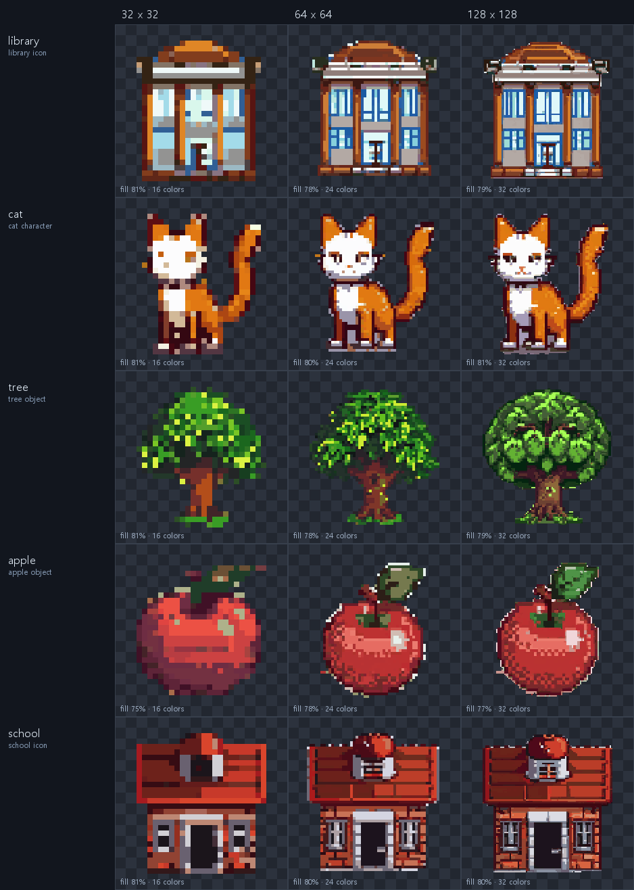
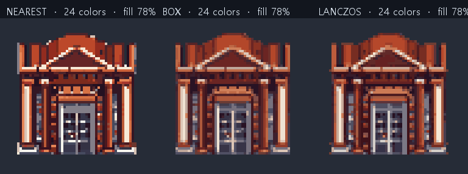

# PixelForge Local 품질 검증 리포트 — 2026-11-10

## 1. 목적

SDXL + pixel-art-xl 결과를 **하나의 게임용 픽셀아트 에셋**으로 만들기 위해
프롬프트 구조화 → 후보 생성 → 피사체 추출 → 구도 보정 → 픽셀화 → 팔레트 정리
파이프라인을 실제 ComfyUI에서 검증했습니다.

이번 검증의 핵심은 다음과 같습니다.

- 아이콘/캐릭터/오브젝트 모드에서 **단일 피사체**만 출력
- 시드 1개에 의존하지 않고 **후보 4개를 생성한 뒤 가장 좋은 결과를 자동 선택**
- 카드/패널/사각 배경이 남은 후보를 **감지해 순위에서 제외**
- 피사체를 **먼저 추출·크롭한 뒤** 목표 해상도로 축소
- 32px에서도 읽히는 실루엣과 제한 팔레트
- 원본/후보 원본/배경 제거/자동 크롭/최종 결과를 모두 보존
- 자동 검증 실패 시 결과를 삭제하지 않고 경고와 미리보기 제공

## 2. 검증 환경

| 항목 | 값 |
|---|---|
| GPU | NVIDIA RTX 3080 Ti 12GB |
| ComfyUI | 0.43.2, `http://127.0.0.1:8188` |
| 체크포인트 | `sd_xl_base_1.0.safetensors` |
| LoRA | `pixel-art-xl.safetensors` (0.8) |
| 배경 분리 | rembg 2.0.87 / u2net (CPU), 25% 패딩 |
| 샘플러 | DPM++ 2M Karras, 28 steps, CFG 6.0 |
| Base resolution | 512×512 |
| 후보 수 | 기본 4개 (최대 8개), 타일 모드는 1개 |
| 후처리 | quantize, nearest 리사이즈, 투명 PNG |
| 팔레트 | 32px=16색, 64px=24색, 128px=32색 |
| 프롬프트 엔진 | 템플릿 (Ollama 미실행 시 자동 대체) |

## 3. 필수 5개 프롬프트 × 32/64/128 결과

모든 작업은 실제 백엔드 API → ComfyUI → 후처리 파이프라인을 통과했습니다.
15개 작업 모두 완료되었고, 15개 모두 **단일 연결 컴포넌트**,
**자동 검증 10/10 통과**, **카드/패널 감지 0건**입니다.

| 케이스 | 모드 | 크기 | 팔레트 | 채움 | 컴포넌트 | 자동 검증 | 선택 후보 | 점수 | Job ID |
|---|---|---|---:|---:|---:|---:|---:|---:|---|
| 도서관 아이콘 | icon | 32 | 16색 | 81% | 1 | 10/10 | #4/4 | 98.6 | `1ac9d3f52a25` |
| 도서관 아이콘 | icon | 64 | 24색 | 78% | 1 | 10/10 | #4/4 | 98.5 | `3b6dc9596e3f` |
| 도서관 아이콘 | icon | 128 | 32색 | 79% | 1 | 10/10 | #4/4 | 99.3 | `215bb2801fbf` |
| 귀여운 고양이 캐릭터 | character | 32 | 16색 | 81% | 1 | 10/10 | #2/4 | 95.1 | `e10738d343c3` |
| 귀여운 고양이 캐릭터 | character | 64 | 24색 | 80% | 1 | 10/10 | #2/4 | 94.3 | `3833c4a9b264` |
| 귀여운 고양이 캐릭터 | character | 128 | 32색 | 81% | 1 | 10/10 | #2/4 | 94.8 | `286a3dde348b` |
| 나무 한 그루 | object | 32 | 16색 | 81% | 1 | 10/10 | #2/4 | 99.8 | `96e8d6c41aa8` |
| 나무 한 그루 | object | 64 | 24색 | 78% | 1 | 10/10 | #2/4 | 99.2 | `15439bd65fc0` |
| 나무 한 그루 | object | 128 | 32색 | 79% | 1 | 10/10 | #3/4 | 99.0 | `97a00b4f46d4` |
| 빨간색 사과 하나 | object | 32 | 16색 | 75% | 1 | 10/10 | #1/4 | 98.6 | `516293ed8151` |
| 빨간색 사과 하나 | object | 64 | 24색 | 78% | 1 | 10/10 | #2/4 | 98.7 | `dc92db0999e5` |
| 빨간색 사과 하나 | object | 128 | 32색 | 77% | 1 | 10/10 | #2/4 | 98.8 | `50e31e5d8a55` |
| 작은 학교 건물 | icon | 32 | 16색 | 81% | 1 | 10/10 | #1/4 | 99.8 | `812fbfaf9226` |
| 작은 학교 건물 | icon | 64 | 24색 | 80% | 1 | 10/10 | #1/4 | 99.2 | `9ec7c641380b` |
| 작은 학교 건물 | icon | 128 | 32색 | 80% | 1 | 10/10 | #1/4 | 99.9 | `5dc7d4fdfbf6` |

전체 원본/최종 이미지 비교:



- 32px에서도 도서관 기둥, 고양이 귀/꼬리, 나무 줄기, 사과 잎, 학교 건물 구조가 읽힙니다.
- 채움은 75~81%로 목표 범위(75~85%) 안에 들어왔습니다.
- 모든 최종 PNG는 정확히 32×32 / 64×64 / 128×128 RGBA입니다.
- 미리보기는 32px=×16, 64px=×8, 128px=×4 nearest-neighbor입니다.

### 후보 선택 효과

15개 작업 × 4후보 = **60개 후보**를 생성하고 점수를 비교했습니다.

| 지표 | 값 |
|---|---|
| 선택된 후보 평균 점수 | **98.25** |
| 전체 후보 평균 점수 | 83.96 |
| 10/10 후보 | 51개 |
| 9/10 후보 | 8개 |
| 8/10 후보 | 1개 |
| 카드/패널 의심 후보 | 0개 (최종 선택 기준) |
| 선택 위치 | #1=4, #2=7, #3=1, #4=3 |

- 후보 점수는 자동 검증 통과율에서 시작해 카드/패널 점수, 중복 컴포넌트,
  잘림, 채움 오차, 최대 컴포넌트 비율, 중앙 오프셋을 감점합니다.
- 점수가 가장 높은 후보를 선택하고, 선택된 후보의 시드를 `seed_used`로 기록합니다.
  사용자가 요청한 기준 시드는 `base_seed`에 남습니다.
- 후보별 시드는 `base_seed + index`입니다.
- 모든 후보 원본은 `outputs/candidates/`에 보존되며, 최종 선택본만
  `outputs/originals/`에 복사됩니다.
- 4후보 기준 평균 소요 시간은 **21.13초**(최소 19.48, 최대 23.52)입니다.
  단일 후보 기준 약 8.7초보다 느리지만, 실패/카드 패널 후보를 자동으로 걸러냅니다.

### 자동 검증 항목

| 항목 | 기준 |
|---|---|
| 피사체 크기 | 아이콘 72~90%, 캐릭터 75~98% |
| 중앙 배치 | 중심 오프셋 ≤ 출력 크기의 6% |
| 단일 오브젝트 | 연결 컴포넌트 1개 또는 최대 컴포넌트 ≥ 97% |
| 카드/패널 없음 | 사각 알파 형태 + 밝은 단색 영역 + 균일 테두리 조합 점수 < 0.42 |
| 잘림 없음 | 최종 캔버스 경계에 닿지 않음 |
| 원본 잘림 확인 | 원본 생성 이미지 내부에 피사체가 있음 |
| 투명 배경 | 알파 불투명 비율 3~97% |
| 출력 해상도 | 요청한 정확한 크기 |
| 픽셀 경계 유지 | 미리보기가 정수배 nearest 확대 |
| 팔레트 | 색상 수 계산 가능 |

## 4. 배경 분리 / 피사체 선택

- u2net은 픽셀아트가 프레임을 가득 채우면 전경을 100%에 가깝게 반환하는 문제가 있었습니다.
  이를 해결하기 위해 가장자리 색으로 **25% 패딩**한 이미지를 분리기에 넣습니다.
- 분리 마스크와 테두리 단색 **색상 키**를 결합해 스프라이트 시트의 이음선을 제거합니다.
- 연결 컴포넌트를 분석해 가장 큰 주 피사체를 선택하고, 주 피사체에 붙어 있거나
  매우 가까운 작은 디테일만 유지합니다. 멀리 떨어진 복제 오브젝트는 버립니다.
- 카드/패널 감지기는 알파 footprint의 사각형 비율, 밝고 채도가 낮은 픽셀 비율,
  테두리 밴드의 색상 균일도를 조합해 점수를 냅니다.
  점수가 0.42 이상이면 `no_card_panel` 검증이 실패하고 후보 순위가 내려갑니다.
  정상 15개 원본은 0~0.282, 카드가 남은 기존 원본은 0.43~0.984로 측정되었습니다.
- 후보 중 카드가 없는 결과가 하나라도 있으면 자동으로 그 후보가 선택됩니다.
  모든 후보가 의심스러우면 경고를 표시하고 결과를 삭제하지 않습니다.
- 원본은 항상 `outputs/originals/`에, 모든 후보 원본은 `outputs/candidates/`에 보존되며,
  UI에서 원본/배경 제거/자동 크롭/최종을 나란히 볼 수 있습니다.

## 5. 리사이즈 필터 비교

동일한 도서관 원본을 64px로 처리한 비교입니다.



| 필터 | 특징 | 용도 |
|---|---|---|
| Nearest (기본) | 경계가 가장 선명, 계단 현상 | 기본 픽셀아트 |
| Box | 평균 기반, 노이즈가 적고 깔끔 | 작은 크기/타일 |
| Lanczos | 부드럽고 디테일 보존 | 큰 출력 비교용 |

최종 미리보기는 어떤 필터를 선택해도 항상 nearest-neighbor로 확대됩니다.

## 6. 추가 케이스

| 케이스 | 요청 | 결과 | Job ID |
|---|---|---|---|
| 타일 모드 | `픽셀아트 숲 배경 타일 만들어줘` | 64px RGB, box, 채움 100%, 검증 3/3, 후보 1개 | `070ea71ae559` |
| 중복 오브젝트 | `빨간색 사과 네 개 만들어줘` | 후보 #3/4 선택, 카드/패널 없음, 검증 10/10 | `5b830fe1700c` |
| 중복 오브젝트 (다른 시드) | `빨간색 사과 네 개 만들어줘` | 후보 #1/4 선택, 카드/패널 없음, 검증 10/10 | `375ce732d118` |
| 원본 팔레트 | `나무 한 그루 만들어줘` | 팔레트 0 = 양자화 없이 1,392색 유지, 후보 #2/4, 검증 10/10 | `d8c11a6a996c` |

- 기존 단일 후보 파이프라인에서는 중복 사과 요청이 2×2 스프라이트 시트의 한 칸을
  선택하면서 그 칸의 카드형 배경까지 남는 경우가 있었습니다(`c942eec22e73`).
- 후보 4개를 생성하고 카드/패널 점수로 재순위한 뒤에는 두 중복 사과 테스트 모두
  카드가 없는 후보를 자동 선택했습니다. 이 한계는 해결되었습니다.
- 타일 모드에서만 반복 패턴/배경을 허용하며, 아이콘/캐릭터/오브젝트 모드는
  단일 피사체를 우선합니다. 타일은 단일 피사체 구도가 아니므로 후보 1개만 생성합니다.
- 원본 팔레트 모드는 양자화를 하지 않으므로 색상 수가 많습니다(예: 1,392색).

## 7. 한계 및 주의

- SDXL + LoRA 특성상 시드에 따라 구도가 달라집니다. 필수 테스트는 기준 시드
  `1234567`과 후보 시드 `base_seed + 0..3`으로 재현됩니다.
- u2net이 얇은 무기/장식/손가락 일부를 배경으로 오인할 수 있습니다.
  이 경우에도 원본은 보존되며 UI에서 비교할 수 있습니다.
- 카드/패널 감지는 휴리스틱입니다. 실제로 흰색/사각형인 오브젝트를 카드로
  오인할 수 있습니다. 이 경우에도 삭제하지 않고 경고와 함께 후보 순위만 조정합니다.
- 후보 4개 생성은 단일 생성보다 약 2.4배 오래 걸립니다(평균 21.13초 vs 약 8.7초).
  속도가 우선이면 요청의 `candidates`를 1로 낮출 수 있습니다.
- Ollama가 실행 중이 아니면 템플릿 프롬프트 엔진을 사용합니다. 이번 검증은 템플릿 결과입니다.

## 8. 재현 방법

```bat
cd /d C:\workspace\pix
start.bat
```

Swagger/API로 직접 실행:

```powershell
$body = @{
  prompt = "도서관 아이콘 만들어줘"
  mode = "icon"
  output_size = 32
  seed = 1234567
  steps = 28
  cfg = 6.0
  lora_strength = 0.8
  transparent = $true
  postprocess = "quantize"
  palette_colors = 16
  resize_filter = "nearest"
  candidates = 4
} | ConvertTo-Json

Invoke-RestMethod -Uri "http://127.0.0.1:8765/api/generate" `
  -Method Post -ContentType "application/json" -Body $body
```

검증 스크립트:

```bat
cd /d C:\workspace\pix\backend
.venv\Scripts\python.exe ..\scripts\run_final_tests.py
.venv\Scripts\python.exe ..\scripts\check_edge_cases.py
.venv\Scripts\python.exe ..\scripts\resize_filter_compare.py
```

## 9. 산출물 위치

| 종류 | 경로 |
|---|---|
| AI 원본 (선택본) | `outputs/originals/<job>_original.png` |
| 후보 원본 전체 | `outputs/candidates/<job>_c<index>.png` |
| 배경 제거 | `outputs/cutouts/<job>_cutout.png` |
| 자동 크롭 | `outputs/crops/<job>_crop.png` |
| 최종 픽셀 | `outputs/pixel_art/<job>_pixel_<size>.png` |
| NN 미리보기 | `outputs/previews/<job>_preview_<size>.png` |
| 메타데이터 | `outputs/metadata/<job>.json` |
| 테스트 리포트 | `experiments/final_tests_20261110_101751.json` |
| 비교 시트 | `experiments/final_tests_20261110_101751_checker.png` |
| 추가 케이스 리포트 | `experiments/edge_cases_candidates.json` |
| 리사이즈 비교 | `experiments/resize_compare_42b7eb87222b_64.png` |

이전 단일 후보 기준 결과는 `experiments/final_tests_20261110_093814.json`과
`experiments/final_tests_20261110_093814_checker.png`에 비교용으로 남아 있습니다.
